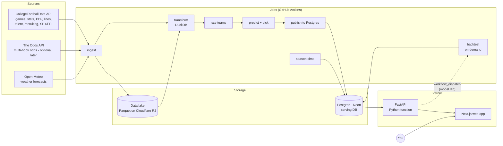

# 02 — Architecture

## The shape of the problem

Most of this system is **batch work**. Data changes on a weekly rhythm: games finish Saturday, stats are final Sunday, lines move Sunday through Saturday. Ratings and predictions get recomputed a few times a week. Nothing needs to be computed on page load except the interactive tools (the hypothetical matchup tool, what-if adjustments, simulations).

That leads to the core design decision:

> **Heavy work runs in scheduled jobs and writes results to a database. The web app reads precomputed results. The API does only light, on-demand math.**

This keeps hosting nearly free. Nothing heavy runs on a server waiting for requests, and the ML dependencies never ship to the web tier.

## System overview



### Two kinds of storage, on purpose

| | **Data lake** (Parquet + DuckDB) | **Serving DB** (Postgres) |
|---|---|---|
| Holds | Everything raw and analytical: play-by-play, drives, box scores, every API response | What the app shows: teams, games, lines, ratings, predictions, picks, contest entries |
| Size | Grows to GBs (PBP is ~150k plays per season) | Stays small, tens of MB |
| Used by | Jobs, notebooks, backtests | API / web app |
| Why | Columnar files are fast for analytics, cheap to store, and easy to reprocess from scratch | Transactional, indexed, good for app queries and your writes |

**Concept: why not just one database?** Neon's free tier caps storage at 0.5 GB, and play-by-play alone would blow through that. More importantly, analytics and app-serving are different workloads. DuckDB can scan millions of plays in seconds right inside a GitHub Actions runner, at no cost. Postgres is good at "give me this week's slate with lines and predictions" in a few milliseconds.

The raw layer is **immutable and append-only**: every API pull is saved as fetched. If we find a bug in a transform or want a new feature, we rebuild from raw without re-spending API calls.

### What's reproducible and what isn't

This distinction drives the backup and "live" rules below:

- **Reproducible from the lake:** reference data (teams, venues, games), historical lines, backtest ratings and predictions.
- **Not reproducible:** your data (contest entries, manual adjustments, models you build in the lab), line snapshots we captured live, and live predictions and picks. Those last two are the honest track record: they record what the model said at the time, and regenerating them after the fact would be cheating.

## Components

### 1. `python/engine`: the model engine (Python library + CLI)
- **ingest**: CFBD client wrapper. Pulls endpoints by season/week and writes raw Parquet. Tracks its own API-call budget.
- **transform**: DuckDB SQL builds clean staging tables (games, team-game stats, plays) and feature tables from raw.
- **models**: rating systems and game predictors, **built from declarative configs** (`ModelSpec`) behind a common interface (see [04-model.md](04-model.md)).
- **backtest**: walk-forward evaluation harness and metrics.
- **simulate**: Monte Carlo season simulations (records, conference titles, later CFP).
- **publish**: upserts reference data and inserts versioned ratings, predictions and picks into Postgres.
- **sports/**: sport-specific code lives behind a `Sport` plugin (`sports/cfb/`, later `sports/nfl/`). Shared code never imports a specific sport.
- Two dependency sets: a **light core** (numpy, scipy, pydantic, which is enough to turn ratings into a prediction and validate a `ModelSpec`) and a **heavy extra** `engine[train]` (polars/pandas, duckdb, scikit-learn, lightgbm, statsmodels). The API depends only on the light core.

Grading is not a job. Pick results, CLV and records are **SQL views** over picks, final scores and closing lines (see [03-data-model.md](03-data-model.md)), so they can never be stale or wrong in storage.

### 2. `python/api`: FastAPI service
- **One endpoint per screen** (BFF-style): `/slate`, `/games/{id}`, `/rankings`, `/teams/{id}`, `/picks`, `/performance`, `/contests/...`, `/lab/...`. Each page makes one API call, and each endpoint runs its DB queries concurrently against a fixed query budget.
- On-demand compute: hypothetical matchups, what-if adjustments (light numpy).
- Writes: contest entries, manual adjustments, lab model specs, watchlist stars and alert settings.
- **Model lab trigger:** "Run backtest" saves a `model_run` with status `queued` and starts the `backtest` GitHub Actions workflow through the GitHub API, using a fine-grained token with only `actions:write` on this repo. The job writes results back to Postgres, and the UI polls the run's status.
- `/api/health` is the **only** route outside the auth gate. It returns the commit SHA, whether the DB is reachable, and the current migration head. No data.
- Deployed to Vercel as a Python function (zero-config FastAPI support, 250 MB bundle limit, which is why the light-core split matters).

### 3. `web/`: Next.js app (TypeScript, App Router)
- UI designed in Claude Design (see [05-ui-design-brief.md](05-ui-design-brief.md)), then implemented here.
- Server components call the API server-side. The browser never talks to the API directly.
- Every data route gets a `loading.tsx` skeleton, which also hides Neon's cold start (1.5–6 s after 5 idle minutes).
- Styling: Tailwind + shadcn/ui. Charts: Recharts or visx.
- A typed API client generated from FastAPI's OpenAPI schema (`openapi-typescript`), so frontend and backend types can't drift. The lab's model-builder form is generated from `ModelSpec`'s JSON Schema.

### 4. Jobs (GitHub Actions)
In-season cadence (all times ET; adjustable):

| Job | When | What |
|---|---|---|
| `results` | Sun 6am, Mon 6am | Ingest final scores, box scores, advanced stats, PBP for the week |
| `rate-and-predict` | Sun 9am | Update ratings, predict next week's games, run season sims |
| `lines` | Daily, plus Thu–Fri evenings (your pick window) | Snapshot CFBD lines; re-evaluate picks when lines move; send watchlist alerts (edge crossed the threshold, or line moved) that haven't been sent yet. From Phase 5, also snapshot Open-Meteo forecasts for this week's outdoor games |
| `scores` | Every ~30 min during game windows (Thu–Sat evenings, Sat all day) | Refresh this week's scores and game status so the record strip grades picks as games finish. CFBD's scoreboard endpoint (confirm it's in tier 1 during Phase 1), about 25 calls a week; NFL contest games from nflverse. Near-live only: scheduled runs can start 10–30 min late |
| `backtest` | On demand (CLI or model lab) | Walk-forward backtest for one model version |
| `backup` | Nightly | `pg_dump` the serving DB, restore it to verify, then store it in R2 |
| `preseason` | Manual, summer | Pull talent, returning production, recruiting; build priors |
| `backfill` | Manual | Historical pulls for new seasons/endpoints |

GitHub Actions gives a private repo 2,000 free minutes a month. Our jobs should run a few minutes each, well within budget.

## Hosting & cost plan

| Need | Choice | Cost | Notes |
|---|---|---|---|
| Web + API | **Vercel Hobby** | $0 | Personal, non-commercial use is fine on Hobby. Prefer one project serving Next.js and the FastAPI function (under `/api/py`), so a release promotes one build. Validate in Phase 0; fall back to two projects promoted together, or Cloud Run for the API |
| Serving DB | **Neon Postgres free** | $0 | 0.5 GB storage, 100 compute-hours/month, scales to zero. Database branches give each PR preview its own DB |
| Data lake + backups | **Cloudflare R2** | $0 | 10 GB free, no egress fees, S3-compatible (DuckDB reads it directly). Needs a card on file |
| Jobs | **GitHub Actions** | $0 | Private repo |
| CFB data | **CFBD API** | $1/mo (current) | Patreon tier 1: 5,000 calls/month. The ~500-call backfill fits; move up to the $5 tier (30k) only if needed |
| Live odds | The Odds API | $0 | Optional/Later. Free: 500 credits/mo |
| Weather | Open-Meteo | $0 | Free forecast API, no key. Phase 5 |
| Alerts | Email (a free transactional tier, e.g. Resend) or web push | $0 | Phase 5; pick one then |
| Auth | **Auth.js** + GitHub OAuth | $0 | Allowlist your account |
| Domain | Optional | ~$12/yr | |

**Expected total: about $1/month.**

## Auth (single user, done properly)

- Next.js uses **Auth.js** with a GitHub OAuth provider and an allowlist of one GitHub ID. Everyone else is rejected.
- A stale or badly signed session cookie **redirects to `/login`**; it never 500s the app.
- Next.js server code calls the API with a short-lived **JWT signed with a shared secret**. The API verifies it on every request except `/api/health`.
- If we later turn on Vercel Deployment Protection, automation (smoke tests) sends the `x-vercel-protection-bypass` header.

## Environments & databases

Four databases from day one, each a Neon branch:

| Env | Web/API | DB | Lake |
|---|---|---|---|
| **development** (`.env`) | `next dev` + `uvicorn` | Neon `dev` branch | local `./data/` |
| **test** | pytest / vitest | Neon `test` branch (or a CI service container) | fixtures |
| **preview** | Vercel preview per PR | Neon `preview/<branch>` (Vercel integration), migrated by the preview build | read-only prod lake |
| **production** | Vercel production | Neon `main` | R2 bucket |

Guards, all enforced in code:
- `.env` points at **development, never production**. Production's URL lives only in a gitignored `.env.live` that scripts read only when passed explicitly (`--env-file .env.live`).
- Tests read **only** `TEST_DATABASE_URL` and refuse to run if it's unset or names the same host and database as `DATABASE_URL`. No fallback. One function owns that decision.
- **`LIVE=true`** (set on production) makes every destructive command (`--rebuild`, truncate, reload) refuse to run. Rebuilding is useful while the DB is disposable; once live picks and contest entries exist, a rebuild would destroy the track record.
- The preview build refuses to migrate if the target host is production's.
- **Pooled vs direct URLs:** the app uses Neon's pooled endpoint (PgBouncer, transaction mode), so psycopg needs prepared statements off (`prepare_threshold=None`) and SQLAlchemy uses `NullPool` in serverless. Migrations and bulk publish jobs use the **unpooled** URL (`DATABASE_URL_UNPOOLED`).
- **One Postgres major version** everywhere: Neon, CI's service container and the backup job's `pg_dump`, set once as `PG_MAJOR`. Install the client from the PGDG apt repo and put `/usr/lib/postgresql/$PG_MAJOR/bin` first on `PATH`.

The engine treats the lake location as config (`LAKE_URI=./data` or `s3://cfb-lake`), so everything runs fully offline on your machine.

## Release & operations

**Merging is not deploying.** Vercel builds every commit on `main` but doesn't promote it. A manual `release` workflow (`workflow_dispatch`, `concurrency: release`, with a dry-run input) puts a build live:

1. **Plan:** pick the newest ready production build for a commit on `main`, and refuse unless CI passed on that exact commit.
2. **Snapshot:** create a Neon branch of production, if there are migrations to apply.
3. **Migrate** (Alembic, unpooled URL) from that commit's migrations, then **re-apply SQL views**.
4. **Promote** the staged build.
5. **Smoke test** `/api/health` on the production domain: right commit, DB reachable, expected migration head.

Schema goes first and code second, so old code briefly runs on the new schema, never the reverse.

**Backups:** the nightly job runs `pg_dump`, checks the exit code and file size, restores the dump into a Postgres service container, re-applies views, runs the view tests, and compares row counts with production (read-only). Only then does it upload to R2 (`backups/`). Only the backup workflow gets write permissions. The lake is already its own backup for everything reproducible.

**Migration checks in CI** (before anything applies a migration):
- `alembic heads` returns exactly one head.
- `alembic check` against a freshly migrated test DB finds no difference between the SQLAlchemy models and the migrations.
- No migration already on `main` was edited, renamed or deleted (a git diff check).
- Any migration that drops or retypes a column has a hand-written downgrade, and its test runs up → down → up and checks row values.

**Dependabot:** watch for majors that need a hand upgrade (Next.js majors, TypeScript 7, which ships no JS API). Ignore them in config with the reason written beside it.

## Repository layout

```
cfb-model/
├── CLAUDE.md                  # Short: status, domain conventions, stop-and-ask rules
├── .claude/
│   ├── rules/                 # Area rules, loaded only for matching paths
│   └── settings.json          # Hooks (e.g. block whole-file reads of data files)
├── README.md
├── docs/                      # This planning set (see doc precedence in CLAUDE.md)
├── python/                    # uv workspace
│   ├── pyproject.toml
│   ├── engine/src/engine/
│   │   ├── core/              # sport-agnostic: interfaces, ModelSpec, probability math
│   │   ├── ingest/  transform/  models/  backtest/  simulate/  publish/
│   │   ├── sports/cfb/        # CFB-specific config, endpoints, features
│   │   └── cli.py             # `engine ingest|transform|rate|predict|simulate|backtest|publish`
│   ├── api/src/api/           # FastAPI app, routers, schemas
│   ├── db/                    # SQLAlchemy models, Alembic migrations, views/*.sql
│   └── notebooks/             # Exploration + learning notebooks (marimo or Jupyter)
├── web/                       # Next.js app
└── .github/workflows/         # ci, release, backup, scheduled jobs
```

### Tooling
- **Python:** `uv` (handles Python versions + workspaces), Python 3.13 pinned for library compatibility, `ruff`, `pytest`, `pyright`. Scripts are Python (engine CLI), not PowerShell/bash pairs.
- **DB:** SQLAlchemy 2.0 + Alembic, `psycopg` 3. Views live in `python/db/views/*.sql` and are re-applied after every migration.
- **Web:** pnpm, Next.js 16 (App Router, `proxy.ts`), TypeScript strict, Tailwind, shadcn/ui, ESLint, Vitest (30 s timeout for shell-spawning tests) + Playwright (light).
- **CI:** lint, typecheck, tests and migration checks on every PR. Vercel deploys a preview per PR.

## Key decisions (ADR summary)

| # | Decision | Why | Revisit if |
|---|---|---|---|
| 1 | Batch-first: precompute, then serve | Cheap, simple, and matches the weekly data rhythm | We need live in-game features |
| 2 | Parquet lake + Postgres serving DB | Free-tier limits; right tool for each workload | Data volume or cost changes |
| 3 | FastAPI on Vercel, not a separate host | One platform, $0 | Bundle size or timeout limits bite, in which case we move to Cloud Run |
| 4 | Engine split into light core + heavy extra | Keeps the API bundle small; the training stack stays in jobs | — |
| 5 | Immutable, versioned ratings/predictions/picks | Honest track record, A/B model comparisons | Never |
| 6 | Derived values (results, records, ranks, CLV) are views, not columns | Can't go stale; no grading job | A view gets too slow, in which case we use a materialized view, not a column |
| 7 | Config-driven models (`ModelSpec`) | Reproducible versions; enables the UI model builder | — |
| 8 | Stable IDs: reference rows upserted by `(source, source_id)`, never truncated and reloaded | Rebuilds can't renumber games under your contest entries | — |
| 9 | Merge ≠ deploy; manual release with migrate-then-promote | No surprise deploys; schema always ahead of code | — |
| 10 | `sport_id` everywhere + `Sport` plugin | Multi-sport later without a rewrite | — |
| 11 | CFBD as primary source | Best free CFB data; historical lines included | Gaps in data quality |

## Risks & mitigations

- **CFBD call budget:** the ingest layer counts calls and caches raw responses. The backfill is planned (see [03-data-model.md](03-data-model.md)) and we never re-fetch final weeks.
- **Neon free compute-hours / connections:** scale-to-zero + low traffic should keep us far under 100 hours. Jobs batch their writes, and endpoints have query budgets.
- **Data leakage in backtests:** "as-of week" is a first-class concept in the data model and the harness (see [04-model.md](04-model.md)).
- **Backtest overfitting through the model lab:** trying many variants and keeping the best one fools you. Holdout seasons stay locked, and the lab shows how many variants were tried (see [04-model.md §6](04-model.md)).
- **Vercel function limits** (bundle 250 MB, 300s on Hobby): the API stays light, and heavy compute never runs there.
