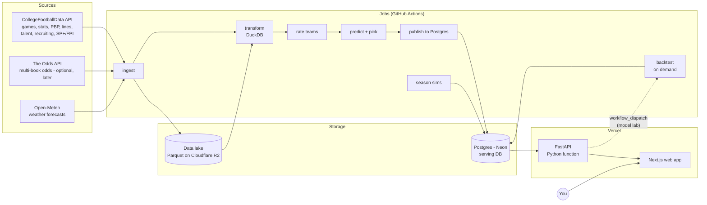

# 02 — Architecture

## The shape of the problem

Most of this system is **batch work**. Data changes on a weekly rhythm: games finish Saturday, stats are final Sunday, lines move Sunday through Saturday. Ratings and predictions get recomputed a few times a week. Nothing needs to be computed on page load except the interactive tools (the hypothetical matchup tool, what-if adjustments, simulations).

That leads to the core design decision:

> **Heavy work runs in scheduled jobs and writes results to a database. The web app reads precomputed results. The API does only light, on-demand math.**

This keeps hosting nearly free. Nothing heavy runs on a server waiting for requests, and the ML dependencies never ship to the web tier.

## System overview



### Two kinds of storage, on purpose

| | **Data lake** (Parquet + DuckDB) | **Serving DB** (Postgres) |
|---|---|---|
| Holds | Everything raw and analytical: play-by-play, drives, box scores, every API response | What the app shows: teams, games, lines, ratings, predictions, picks, contest entries |
| Size | Grows to GBs (PBP is ~150k plays per season) | Stays small, tens of MB |
| Used by | Jobs, notebooks, backtests | API / web app |
| Why | Columnar files are fast for analytics, cheap to store, and easy to reprocess from scratch | Transactional, indexed, good for app queries and your writes |

**Concept: why not just one database?** Neon's free tier caps storage at 0.5 GB, and play-by-play alone would blow through that. More importantly, analytics and app-serving are different workloads. DuckDB can scan millions of plays in seconds right inside a GitHub Actions runner, at no cost. Postgres is good at "give me this week's slate with lines and predictions" in a few milliseconds.

The raw layer is **immutable and append-only**: every API pull is saved as fetched. If we find a bug in a transform or want a new feature, we rebuild from raw without re-spending API calls.

### What's reproducible and what isn't

This distinction drives the backup and "live" rules below:

- **Reproducible from the lake:** reference data (teams, venues, games), historical lines, backtest ratings and predictions.
- **Not reproducible:** your data (contest entries, manual adjustments, models you build in the lab), line snapshots we captured live, and live predictions and picks. Those last two are the honest track record: they record what the model said at the time, and regenerating them after the fact would be cheating.

## Components

### 1. `python/engine`: the model engine (Python library + CLI)
- **ingest**: CFBD client wrapper. Pulls endpoints by season/week and writes raw Parquet. Tracks its own API-call budget.
- **transform**: DuckDB SQL builds clean staging tables (games, team-game stats, plays) and feature tables from raw.
- **models**: rating systems and game predictors, **built from declarative configs** (`ModelSpec`) behind a common interface (see [04-model.md](04-model.md)).
- **backtest**: walk-forward evaluation harness and metrics.
- **simulate**: Monte Carlo season simulations (records, conference titles, later CFP).
- **publish**: upserts reference data and inserts versioned ratings, predictions and picks into Postgres.
- **sports/**: sport-specific code lives behind a `Sport` plugin (`sports/cfb/`, later `sports/nfl/`). Shared code never imports a specific sport.
- Two dependency sets: a **light core** (numpy, scipy, pydantic, which is enough to turn ratings into a prediction and validate a `ModelSpec`) and a **heavy extra** `engine[train]` (polars/pandas, duckdb, scikit-learn, lightgbm, statsmodels). The API depends only on the light core.

Grading is not a job. Pick results, CLV and records are **SQL views** over picks, final scores and closing lines (see [03-data-model.md](03-data-model.md)), so they can never be stale or wrong in storage.

#### Ratings depth: units, schedule strength and team stats (added 2026-10-20)
The model detail is [04-model.md § 10](04-model.md); the decision is D-117.
- **Shown vs used.** The weekly job computes every unit rating, opponent-removed stat, SOS and SOR for every team, entering every week and point-in-time, whether or not the production model uses it. The `ModelSpec` picks the inputs that feed predictions, and the backtest decides which earn a place. So a display feature never waits on a model change, and a model change never removes a display.
- **The overall rating is the sum of its units** (offense + defense + special teams, in points), so the drivers, the unit profile and the inputs explainer all read the same numbers.
- **One input registry** in `engine.core` describes every metric once (label, definition, unit, direction, source, garbage-time handling). `ModelSpec`, the Lab's weights view and builder form, the inputs explainer and the API's unit labels all read it. It's light-core code, so the API can serve it.
- **Where each piece lives**, following hard rule 1:

  | Piece | Kind | Lives in |
  |---|---|---|
  | Per-game team stats (box score, advanced, PBP-derived with our garbage-time filter) | fact | lake `staging/` and `features/`; Postgres table upserted by source key (proposed, [03 › Proposed additions for ratings depth](03-data-model.md#proposed-additions-for-ratings-depth-2026-10-20-not-approved)) |
  | Season-to-date and opponent-removed stats | aggregate of facts | SQL views over that table |
  | Unit ratings | model output | `team_ratings.components` and `st_rating` (existing columns) |
  | SOS of games played | aggregate of stored ratings | view `team_schedule_strength` (MVP, M3.7) |
  | SOR, remaining and full-season SOS | model output (needs Φ and the Poisson binomial) | engine, per model run, insert-only like `season_simulations` (proposed) |
  | Confidence levels | function of stored `model_prob` and spec cutoffs | computed on read, never stored |
- **Call budget.** The units need no new CFBD endpoints: they come from advanced stats, plays and drives, which the Phase 1 backfill already pulls. Position-group ratings (Phase 7 research) would need the player endpoints, so their call cost is estimated before any pull.

### 2. `python/api`: FastAPI service
- **One endpoint per screen** (BFF-style): `/slate`, `/games/{id}`, `/rankings`, `/teams/{id}`, `/picks`, `/performance`, `/contests/...`, `/lab/...`. Each page makes one API call, and each endpoint runs its DB queries concurrently against a fixed query budget.
- On-demand compute: hypothetical matchups, what-if adjustments (light numpy).
- Writes: contest entries, manual adjustments, lab model specs, watchlist stars and alert settings.
- **Model lab trigger:** "Run backtest" saves a `model_run` with status `queued` and starts the `backtest` GitHub Actions workflow through the GitHub API, using a fine-grained token with only `actions:write` on this repo. The job writes results back to Postgres, and the UI polls the run's status.
- `/api/py/health` is the **only** route outside the auth gate. It returns the commit SHA, whether the DB is reachable, and the current migration head. No data.
- Deployed to Vercel as a Python function (zero-config FastAPI support, 250 MB bundle limit, which is why the light-core split matters).

### 3. `web/`: Next.js app (TypeScript, App Router)
- UI designed in Claude Design (see [05-ui-design-brief.md](05-ui-design-brief.md)), then implemented here.
- Server components call the API server-side. The browser never talks to the API directly.
- Every data route gets a `loading.tsx` skeleton, which also hides Neon's cold start (1.5–6 s after 5 idle minutes).
- Styling: Tailwind + shadcn/ui. Charts: Recharts or visx.
- A typed API client generated from FastAPI's OpenAPI schema (`openapi-typescript`), so frontend and backend types can't drift. The lab's model-builder form is generated from `ModelSpec`'s JSON Schema.

### 4. Jobs (GitHub Actions)
In-season cadence (all times ET; adjustable). Jobs run in GitHub Actions but are **started by the dispatcher**, not GitHub's `schedule` trigger (D-122): a Cloudflare Worker (`infra/dispatcher/`, README › Dispatcher) ticks every 15 minutes, converts the time to ET, and sends a `workflow_dispatch` for each job due in that quarter hour. GitHub's schedule is best effort, and the backup's scheduled runs started 5–8 hours late (2026-10-13 to 10-15), not the 10–30 minutes this doc first assumed. Doing the ET conversion in the Worker keeps each job at its ET time across daylight saving, so no job needs two crons per slot. Job times sit on quarter hours and never between 01:00 and 02:59 ET, which daylight saving repeats or skips. The table below is the plan; the dispatcher's `SCHEDULE` is what runs, and lists only the jobs built so far.

| Job | When | What |
|---|---|---|
| `results` | Sun 6am, Mon 6am | Ingest final scores, box scores, advanced stats, PBP for the week |
| `rate-and-predict` | Sun 9am | Update ratings, predict next week's games, run season sims; from Phase 5 also unit ratings, SOR and remaining SOS |
| `lines` | Daily, plus Thu–Fri evenings (your pick window) | Snapshot CFBD lines; re-evaluate picks when lines move; send watchlist alerts (edge crossed the threshold, or line moved) that haven't been sent yet. From Phase 5, also snapshot Open-Meteo forecasts for this week's outdoor games |
| `scores` | Every ~30 min during game windows (Thu–Sat evenings, Sat all day) | Refresh this week's scores and game status so the record strip grades picks as games finish. CFBD's scoreboard endpoint (confirm it's in tier 1 during Phase 1), about 25 calls a week; NFL contest games from nflverse. Near-live only: a dispatched run starts within minutes of its slot, plus the runner's queue time |
| `backtest` | On demand (CLI or model lab) | Walk-forward backtest for one model version |
| `backup` | Nightly, 03:30 | `pg_dump` the serving DB, restore it to verify, then store it in R2 |
| `preseason` | Manual, summer | Pull talent, returning production, recruiting; build priors |
| `backfill` | Manual | Historical pulls for new seasons/endpoints |

GitHub Actions gives a private repo 2,000 free minutes a month. Our jobs should run a few minutes each, well within budget.

## Hosting & cost plan

| Need | Choice | Cost | Notes |
|---|---|---|---|
| Web + API | **Vercel Hobby** | $0 | Personal, non-commercial use is fine on Hobby. Prefer one project serving Next.js and the FastAPI function (under `/api/py`), so a release promotes one build. Validate in Phase 0; fall back to two projects promoted together, or Cloud Run for the API |
| Serving DB | **Neon Postgres free** | $0 | 0.5 GB storage, 100 compute-hours/month, scales to zero. Database branches give each PR preview its own DB |
| Data lake + backups | **Cloudflare R2** | $0 | 10 GB free, no egress fees, S3-compatible (DuckDB reads it directly). Needs a card on file |
| Jobs | **GitHub Actions**, started by a **Cloudflare Worker** | $0 | Private repo. The Worker's Cron Trigger dispatches each job at its ET time (§ Components 4, D-122); Workers' free plan |
| CFB data | **CFBD API** | $1/mo (current) | Patreon tier 1: 5,000 calls/month. The ~500-call backfill fits; move up to the $5 tier (30k) only if needed |
| Live odds | The Odds API | $0 | Optional/Later. Free: 500 credits/mo |
| Weather | Open-Meteo | $0 | Free forecast API, no key. Phase 5 |
| Alerts | Email (a free transactional tier, e.g. Resend) or web push | $0 | Phase 5; pick one then |
| Auth | **Auth.js** + GitHub OAuth | $0 | Allowlist your account |
| Domain | Optional | ~$12/yr | |

**Expected total: about $1/month.**

## Auth (single user, done properly)

- Next.js uses **Auth.js** with a GitHub OAuth provider and an allowlist of one GitHub ID. Everyone else is rejected.
- A stale or badly signed session cookie **redirects to `/login`**; it never 500s the app.
- Next.js server code calls the API with a short-lived **JWT signed with a shared secret**. The API verifies it on every request except `/api/py/health`.
- Previews are behind Vercel Deployment Protection (Vercel Authentication), so automation that calls a preview (the Lighthouse job) sends the `x-vercel-protection-bypass` header; so does automation that calls production (smoke tests) if protection ever covers it.
- Preview and production use different `AUTH_SECRET`s, so a session minted for a preview (the Lighthouse job) can never open production.
- Previews have no GitHub sign-in (D-102). Each preview has its own URL, and GitHub can't safely allow-list them all, so only minted sessions reach a preview. Two OAuth apps with exact callbacks: "CFB Model" (the production domain) and "CFB Model (dev)" (`localhost:3000`).

## Environments & databases

Four databases from day one, each a Neon branch:

| Env | Web/API | DB | Lake |
|---|---|---|---|
| **development** (`.env`) | `next dev` + `uvicorn` | Neon `dev` branch | the R2 lake for every CFBD call (its ledger is the jobs'), mirrored to local `./data/` by `engine lake sync` for rebuilds, notebooks and the dev publish (TASK-021, D-121) |
| **test** | pytest / vitest | Neon `test` branch (or a Postgres container in CI) | fixtures |
| **preview** | Vercel preview per PR | Neon `preview/<branch>` (Vercel integration), migrated by the preview build, deleted when the PR closes (`neon-preview-cleanup.yml`) | read-only prod lake |
| **production** | Vercel production | Neon `main` | R2 bucket |

Guards, all enforced in code:
- `.env` points at **development, never production**. Production's URL lives only in a gitignored `.env.live` that scripts read only when passed explicitly (`--env-file .env.live`).
- Tests read **only** `TEST_DATABASE_URL` and refuse to run if it's unset or names the same host and database as `DATABASE_URL`. No fallback. One function owns that decision.
- **`LIVE=true`** (set on production) makes every destructive command (`--rebuild`, truncate, reload) refuse to run. Rebuilding is useful while the DB is disposable; once live picks and contest entries exist, a rebuild would destroy the track record.
- The preview build refuses to migrate if the target host is production's.
- **Pooled vs direct URLs:** the app uses Neon's pooled endpoint (PgBouncer, transaction mode), so psycopg needs prepared statements off (`prepare_threshold=None`) and SQLAlchemy uses `NullPool` in serverless. Migrations and bulk publish jobs use the **unpooled** URL (`DATABASE_URL_UNPOOLED`).
- **One Postgres major version** everywhere: Neon, CI's Postgres container, and the backup job's `pg_dump` and restore container, set once as `PG_MAJOR` in the `start-postgres` action (`.github/actions/start-postgres/action.yml`) that CI and the backup share (D-109). Install the client from the PGDG apt repo and put `/usr/lib/postgresql/$PG_MAJOR/bin` first on `PATH`.

The engine treats the lake location as config (`LAKE_URI=./data` or `s3://cfb-lake`), so everything runs fully offline on your machine.

## Release & operations

**Merging is not deploying.** Vercel builds every commit on `main` but doesn't promote it. A manual `release` workflow (`workflow_dispatch`, `concurrency: release`, with a dry-run input) puts a build live:

1. **Plan:** pick the newest ready production build for a commit on `main`, and refuse unless CI passed on that exact commit.
2. **Snapshot:** create a Neon branch of production, `release/<YYYYMMDD-HHMM>-<sha7>`, if there are migrations to apply.
3. **Migrate** (Alembic, unpooled URL) from that commit's migrations, then **re-apply SQL views**.
4. **Promote** the staged build.
5. **Smoke test** `/api/py/health` on the production domain: right commit, DB reachable, expected migration head. An unsigned `GET /api/py/teams` must also answer 401, so a build without the API guard (or its `API_JWT_SECRET`) can't pass (D-107).

Schema goes first and code second, so old code briefly runs on the new schema, never the reverse.

**Backups:** the nightly `backup` workflow runs `pg_dump` through a read-only role, checks the exit code and file size, restores the dump into a `postgres:PG_MAJOR` container started in a step, re-applies the views of the commit production serves, queries each view, and compares row counts with production's, counted in the dump's own snapshot. Only then does it upload to R2, in a bucket of its own, at every key for the run's UTC date: `backups/daily/<date>.dump` always, `backups/weekly/<date>.dump` on a Sunday and `backups/monthly/<date>.dump` on the 1st. R2 lifecycle rules in the bucket's settings, set by the owner, expire them after 14, 90 and 365 days, so a problem noticed weeks late can still be rolled back while storage stays bounded (D-124). Its GitHub permissions are read-only (`contents: read`); it writes R2 with a token scoped to the backup bucket, so nothing else can overwrite a backup and the backup can't touch the lake (D-109). The restore steps are in [docs/runbooks/restore.md](runbooks/restore.md). The lake is already its own backup for everything reproducible.

**Migration checks in CI** (before anything applies a migration):
- `alembic heads` returns exactly one head.
- `alembic check` against a freshly migrated test DB finds no difference between the SQLAlchemy models and the migrations.
- No migration already on `main` was edited, renamed or deleted (a git diff check).
- Any migration that drops or retypes a column has a hand-written downgrade, and its test runs up → down → up and checks row values.

**Dependabot:** watch for majors that need a hand upgrade (Next.js majors, TypeScript 7, which ships no JS API). Ignore them in config with the reason written beside it.

## Repository layout

```
cfb-model/
├── CLAUDE.md                  # Short: status, domain conventions, stop-and-ask rules
├── .claude/
│   ├── rules/                 # Area rules, loaded only for matching paths
│   └── settings.json          # Hooks (e.g. block whole-file reads of data files)
├── README.md
├── docs/                      # This planning set (see doc precedence in CLAUDE.md)
├── python/                    # uv workspace
│   ├── pyproject.toml
│   ├── engine/src/engine/
│   │   ├── core/              # sport-agnostic: interfaces, ModelSpec, probability math
│   │   ├── ingest/  transform/  models/  backtest/  simulate/  publish/
│   │   ├── sports/cfb/        # CFB-specific config, endpoints, features
│   │   └── cli.py             # `engine ingest|transform|rate|predict|simulate|backtest|publish`
│   ├── api/src/api/           # FastAPI app, routers, schemas
│   ├── db/                    # SQLAlchemy models, Alembic migrations, views/*.sql
│   └── notebooks/             # Exploration + learning notebooks (marimo or Jupyter)
├── web/                       # Next.js app
├── infra/dispatcher/          # Cloudflare Worker that starts the scheduled jobs on time (D-122)
└── .github/workflows/         # ci, release, backup, scheduled jobs
```

### Tooling
- **Python:** `uv` (handles Python versions + workspaces), Python 3.13 pinned for library compatibility, `ruff`, `pytest`, `pyright`. Scripts are Python (engine CLI), not PowerShell/bash pairs.
- **DB:** SQLAlchemy 2.0 + Alembic, `psycopg` 3. Views live in `python/db/views/*.sql` and are re-applied after every migration.
- **Web:** pnpm, Next.js 16 (App Router, `proxy.ts`), TypeScript strict, Tailwind, shadcn/ui, ESLint, Vitest (30 s timeout for shell-spawning tests) + Playwright (light).
- **CI:** lint, typecheck, tests and migration checks on every PR. Vercel deploys a preview per PR.

## Key decisions (ADR summary)

| # | Decision | Why | Revisit if |
|---|---|---|---|
| 1 | Batch-first: precompute, then serve | Cheap, simple, and matches the weekly data rhythm | We need live in-game features |
| 2 | Parquet lake + Postgres serving DB | Free-tier limits; right tool for each workload | Data volume or cost changes |
| 3 | FastAPI on Vercel, not a separate host | One platform, $0 | Bundle size or timeout limits bite, in which case we move to Cloud Run |
| 4 | Engine split into light core + heavy extra | Keeps the API bundle small; the training stack stays in jobs | — |
| 5 | Immutable, versioned ratings/predictions/picks | Honest track record, A/B model comparisons | Never |
| 6 | Derived values (results, records, ranks, CLV) are views, not columns | Can't go stale; no grading job | A view gets too slow, in which case we use a materialized view, not a column |
| 7 | Config-driven models (`ModelSpec`) | Reproducible versions; enables the UI model builder | — |
| 8 | Stable IDs: reference rows upserted by `(source, source_id)`, never truncated and reloaded | Rebuilds can't renumber games under your contest entries | — |
| 9 | Merge ≠ deploy; manual release with migrate-then-promote | No surprise deploys; schema always ahead of code | — |
| 10 | `sport_id` everywhere + `Sport` plugin | Multi-sport later without a rewrite | — |
| 11 | CFBD as primary source | Best free CFB data; historical lines included | Gaps in data quality |

## Risks & mitigations

- **CFBD call budget:** the ingest layer counts calls and caches raw responses. The backfill is planned (see [03-data-model.md](03-data-model.md)) and we never re-fetch final weeks.
- **Neon free compute-hours / connections:** scale-to-zero + low traffic should keep us far under 100 hours. Jobs batch their writes, and endpoints have query budgets.
- **Data leakage in backtests:** "as-of week" is a first-class concept in the data model and the harness (see [04-model.md](04-model.md)).
- **Backtest overfitting through the model lab:** trying many variants and keeping the best one fools you. Holdout seasons stay locked, and the lab shows how many variants were tried (see [04-model.md §6](04-model.md)).
- **Vercel function limits** (bundle 250 MB, 300s on Hobby): the API stays light, and heavy compute never runs there.
- **Splash paste format** (added 2026-10-07): the Thursday contest flow depends on parsing a page we don't control, and its text shape can change without notice. The parser is tested against a real page copy (`design/sample-splash-10062026.txt`); unmatched rows fall back to an inline team picker, and manual entry always works. The parser spike moved forward to M2.8 (TASK-023): it's tested on a fresh full-page copy (`design/sample-splash-10152026.txt`) long before the Contest screen is built on it.

## Testing strategy

_Added 2026-10-07 (D-089, D-090). The tools come from the Tooling section above. This section fixes what each level covers and which seed data acceptance criteria may cite. The rules in `.claude/rules/` still apply: no wall-clock assertions, and tests read only `TEST_DATABASE_URL` through the single guard function._

### Levels
| Level | Tool | Covers | Runs in |
|---|---|---|---|
| Unit: engine | pytest | Probability math (Φ(edge/σ), edge, EV); pick and tier rules read from a `ModelSpec`; `ModelSpec` and `ContestRules` validation; the Splash paste parser, run on `design/sample-splash-10062026.txt` (a real page copy) and on the Week 6 paste; point-in-time assertions; the test-DB guard and the `LIVE` guard | `verify.full`, CI |
| Unit: web | Vitest | `format.ts` against every example on the number-format card (`OSU −27.5`, `BSU −10` padded, `PK`, `−110`, `CLEM −34.0`, `+3.7 OSU`, `59%`, `~54%`, `TEX 54%`, `+27.4`, `▲3 ▼1 —`, `31-24-1`, `5-0`, `+4.6u`, `−1.1u`, `+0.9 pts`, `Sat 3:30 PM ET`, `Locks in 1d 14h`, `PUR 3 · OSU 24`, `Q3 9:12`); component states (edge pill threshold, tier badge, result marker, lock countdown); pick-tray logic (tap, re-tap to clear, switch side) | `verify.full`, CI |
| Integration: database | pytest against Postgres: a CI Postgres container on `PG_MAJOR`, or the Neon `test` branch locally | Migrations: one head, `alembic check`, up → down → up for destructive changes. Every view in [03 › Views](03-data-model.md#views-derived-data-lives-here) against the fixture with expected values (e.g. `model_record` for v1.0 in 2026 = 31-24-1, +4.6u). `EXPLAIN` shows no full scan for single-item reads. Upsert by `(source, source_id)` is idempotent. Ratings, predictions and picks are never UPDATEd or DELETEd | CI |
| Integration: API | pytest with FastAPI's TestClient on the seeded test DB | Each screen endpoint returns the fixture values; every route except `/api/py/health` requires the JWT; each endpoint's query count stays within its budget; a contest entry after kickoff is rejected | CI |
| Contract | `openapi-typescript` + `tsc` | The generated client matches the API's current OpenAPI schema; CI fails on drift | CI |
| Data / ETL | pytest on a small lake fixture of recorded CFBD responses (no network) | `transform --rebuild` from raw with zero API calls; the data-quality checks in [03](03-data-model.md#data-quality-checks-run-after-each-ingest); "no future data" (max source time < `as_of`); the call-budget tracker counts every call | CI |
| Model / backtest | pytest on a tiny lake fixture (a two-season subset) | Determinism: same spec + same inputs → identical metrics, checked against golden numbers that change only in a commit that says why. Leakage: changing any game after week N leaves week-N predictions unchanged. The harness refuses hindsight ratings, and refuses holdout seasons without the holdout flag ([04 § 9](04-model.md#9-evaluation-protocol-fixed-2026-10-07)) | CI |
| End to end | Playwright against `next start` + `uvicorn` on the seeded test DB, fixed clock, viewports 390×844 and 1440×900 | The journeys below | CI (e2e job); ui-verifier agent |
| Visual reference | Playwright screenshots reviewed against `design/handoff/screenshots/` | Layout and component drift. No pixel-diff assertions (font rendering differs), but with the fixture the numbers on screen should match the reference shots exactly | ui-verifier, PR review |
| Performance | Lighthouse on each PR: a build served inside the job on the seeded fixture DB (gated), and the PR's preview (reported only) (D-125, § Performance checks below) | Bytes, requests, CLS and accessibility against `scripts/perf/budget.json` and forbidden requests (gated, fixture run); timings reported only | `lighthouse` workflow on `pull_request` and `deployment_status`; its pure logic in Vitest |
| Operations | GitHub Actions run on the branch (`gh workflow run <file> --ref <branch>`) | `release` dry run; `backup` restore verification | On demand |

### End-to-end journeys
Screen and feature IDs: [05 › Screen inventory](05-ui-design-brief.md#screen-inventory-from-handoff), [01 › Feature index](01-product.md#feature-index-ids-priorities-outcomes).
1. Signed out, `/` redirects to `/login`, which shows "Sign in with GitHub". With the test session, This Week shows "2026 · Week 6 · 54 games · 9 picks" (S-15, S-01).
2. This Week → Texas vs Oklahoma: The Number reads "TEX −6.5 · TEX −1.3 · +5.2 OU · 63%" (S-01 → S-03).
3. Contest at Thu 10:00 PM: paste the Week 6 text → "9 rows match · 1 unmatched" → map "Hou Texans" / "Jax" → Confirm → ranked slate with the cutoff under #4 (S-02).
4. Contest: pick OU +7 and BUF −3 → the tray reads "2 of 4". At Fri 8:12 PM, UNLV @ Boise State shows "Picks closed" and the API rejects an entry for it (S-02).
5. Picks › Best lines → the "Splash only" chip drops Iowa, Kentucky, Northwestern and Utah (S-07).
6. Rankings → the "SEC" chip leaves 5 rows; the time machine one week back shows the past-week banner (S-04).
7. At 390 px: This Week renders cards and the bottom tab bar, with no horizontal scroll and every tap target ≥ 44 px (S-01, S-16).
8. With the API stopped, the page shows the "API unreachable" state with Retry; after the API restarts, data loads (S-16).

### Test-only sign-in and clock
- **Sign-in:** e2e mints a session cookie with the test `AUTH_SECRET`. The helper lives in the Playwright fixtures, never in `web/` source, so production has no way in except GitHub.
- **Dev sign-in (ui-verifier):** `web/e2e/dev-session.mjs <url>` mints the same cookie for the local dev server with the dev `AUTH_SECRET`, read from the repo root's `.env.local` only, valid 1 hour, and refuses any URL that isn't `http:` on a loopback host (D-111). It sits beside e2e's mint; a Vitest case fails if app source imports from `e2e/`.
- **Clock:** the engine and the web app each read "now" from one clock function, which honors `FIXTURE_NOW` only when `APP_ENV=test`. The fixture uses four times:
  - Thu 2026-10-08 10:00 PM ET: Contest, Best lines.
  - Fri 2026-10-09 8:12 PM ET: the locked game.
  - Sat 2026-10-10 2:15 PM ET: slate, Picks, Game Detail, Team.
  - Mon 2027-02-08 6:00 AM ET: off-season.

### Seed data (what acceptance criteria cite)
- **Source:** `design/sample-data.md` §1–8, plus the illustrative rows the boards added (e.g. week 1–5 picks and the Week 6 paste in `design/handoff/designs/contest-data.js`). These are copied into a fixture under `python/db/seeds/fixture/`; nothing reads `design/` at runtime. Every fixture row has `source = 'fixture'`, so it can never collide with a real CFBD row.
- **Where it loads:** the test DB only (CI and local e2e). `db:seed` refuses any target except `TEST_DATABASE_URL`, using the same guard as the tests, and refuses under `LIVE=true`. Dev, preview and production never receive fixture rows.
- **Generated rows:** where the sample gives only totals (filler games, graded picks for weeks 1–5), rows are generated deterministically with a fixed random seed so the totals come out exact.
- **Screenshot vs sample-data:** where a screenshot and `sample-data.md` disagree on something the app computes, the screenshot is the expected value. Example: `03-contest-desktop.png` ranks ND (55%) #5, above BUF (~54%), while `sample-data.md` lists BUF #5.

| Area | Fixture contents | Values ACs cite (reference shot) |
|---|---|---|
| Season and clock | 2026, current week 6; the four fixed times above | "2026 · Week 6" (01) |
| Teams and venues | Every team in sample-data §1–6, plus filler FBS teams, with team colors from `*-data.js`; the NFL teams on the contest slate; Cotton Bowl (neutral site) and Camp Randall (outdoor) | Team chips everywhere |
| Week 6 games | 54 CFB games. The 11 slate rows with their statuses and scores (UNLV 24, BSU 31 final; PUR 3, OSU 24, Q3 9:12; IOWA 10, WIS 7, Q2 2:41). Tulane @ Memphis Thursday, final 27-24. Iowa State @ Cincinnati and Arizona State @ Baylor. Filler games with edges under 1.0. The 5 NFL games from §3 | "54 games · 9 picks", "Showing 11 of 54 games" (01) |
| Line snapshots | Opening and current lines per §1. Texas vs Oklahoma: Sun −7 → Tue −6.5 → Thu −6 → Sat −6.5, plus Mon 9:40 AM −6.5 where the OU pick was made. Iowa @ Wisconsin −1.5 from Tue 11:20 AM, where the Iowa pick was made (D-140). BYU −7 → −6 on Wed 7:04 PM. Ohio State's weeks 1–7 lines per §6. None for Furman @ Clemson | "−28 ⟍ OSU −27.5", "No line" (01, 05) |
| Model registry | v1.0 production (spec and fitted params per §8), v1.1 candidate, v1.2-dev; 7 variants since the last promotion. Backtest metrics in `model_runs.metrics`: Validation 2016–2023 54.1%, 1,184 picks, ROI +3.3%; Holdout 2024–2025 53.2%, 263 picks, ROI +1.6%; MAE 12.9 vs closing 12.6; the edge-bucket and calibration tables in §7 | (13, 15) |
| Ratings | Entering week 6 for the top 10 (§4) and the filler teams; entering week 5, so Δ computes; Ohio State's trajectory +24.0 → +27.4 | (07, 09) |
| Predictions and picks | Week 6 predictions for every game, with Texas vs Oklahoma's drivers and σ 13.8 per §2. The 9 week-6 picks (Ole Miss picked at LSU −2.5, Sun 6:10 AM). 56 graded 2026 picks in weeks 1–5 adding up to 31-24-1, +4.6u, ROI +7.6%, avg CLV +0.9; tiers A 7-3, B 12-9-1, C 12-12; cumulative units W1 +1.8 … W5 +4.6. The picks, their weeks 1–5 games, lines and predictions, and the three week-6 games the slate doesn't show are `picks.json`, written by `generate_picks.py` beside it (TASK-040, D-140) | (01, 11, 13) |
| Contest | "Splash work league" with the Splash preset rules; week 6 contest lines from the Week 6 paste; entries OU +7 (Thu 9:14 PM) and BUF −3 (Thu 9:20 PM); weeks 1–5 entries giving you 12-8 and the model top 4 11-9; standing 3rd of 14 | (03, 04) |
| User | One allowlisted user; theme dark, time zone America/New_York, default contest "Splash work league" | — |
| Phase 5 rows (added with their migrations) | Season simulations per §5 (no P(CFP) until Phase 7); weather snapshots (Iowa @ Wisconsin: wind 17 mph, gusts 26; Kentucky @ Georgia: rain 80%); the BYU alert; Texas vs Oklahoma and Iowa @ Wisconsin starred | (01, 18) |
| State fixtures | "offseason": 2027 week 0, no games, 2026 final record 61-48-2, +8.2u, CLV +0.8. "preseason team": Ohio State before week 1. Loaded per test | (20, 21) |

### Performance checks (Lighthouse)

_Added 2026-10-08 (D-101). The pattern comes from the owner's `ledger` project (`.github/workflows/lighthouse.yml`, `scripts/perf/`, `test/perf.test.ts`); use it as a pattern, not a template, since its host, sign-in and routes differ._

Every PR is measured with Lighthouse automatically. The job **fails the PR only on numbers that stay put between runs** and reports everything else in a PR comment.

**Where it measures (D-125, which amends D-101):** two kinds of run, each with its own PR comment.
- **Fixture run (gated):** a build served inside the job on the seeded fixture DB, the way e2e runs (`next start` + uvicorn, `APP_ENV=test`), so every run sees the same data and bytes move only when the code does. A data-heavy page's large instance is fixture data added by the task that owns the table (D-089).
- **Preview run (reported only):** each PR's Vercel preview, measured the same way on its own data. Its numbers are shown and compared with no budget, and it never fails a check; anything the gates would have caught (a forbidden request, CLS, a route that didn't measure) is listed as noticed.

**Gates (fail the fixture run):**
- a forbidden request during a page load or prefetch, named in the failure (e.g. a nav `<Link>` prefetch hitting an `/api/py/*` route; the browser never calls the API, per hard rule 5)
- per route: document bytes (plus the RSC payload), JS bytes, or request count over budget
- CLS ≥ 0.1
- an accessibility score below the recorded one
- a route that never finished measuring, or that landed somewhere unexpected (a redirect to `/login` means the session didn't take)

**Reported, never gated:** TTFB, FCP, LCP and TBT in both runs, shown as first hit / median next to the baseline. Timings on a preview depend on whether Neon and the functions are cold, which is luck, and a shared runner is no steadier. That matches § Non-functional requirements: latency is measured, never asserted.

**Measurement profile:** Lighthouse mobile, `--throttling-method=devtools` (Slow 4G, 4× CPU), `--only-categories=performance,accessibility`, three runs per route, median. Lighthouse (and puppeteer-core, if used) are pinned in a separate `scripts/perf/package.json` that only the workflow installs (`npm ci --prefix scripts/perf`), never the app build; it stays out of `pnpm-workspace.yaml`. Chrome on Actions needs `--no-sandbox`. Vercel extras are left out of the counts: send `x-vercel-skip-toolbar: 1` and drop `vercel.live` / `_next-live` requests.

**Triggers:** `pull_request` runs the fixture run, except on a PR that changes only `docs/`, `.claude/`, `backups/` or root `*.md` (`paths-ignore`, the same list as CI's scope step in `scripts/lib/ci-scope.mjs`; a test keeps them in step). `deployment_status` with `state == success` on the Preview environment runs the preview run. `workflow_dispatch` measures a preview given a `url` input, or the fixture on the chosen ref given none. Production's URL lives in a repo variable; the job refuses it unless an `allow_production` input is ticked.

**Signing in:** sign-in is GitHub-only, which a script can't do, so the job mints an Auth.js session cookie, the same way e2e does (§ Test-only sign-in and clock). The fixture run signs with e2e's test-only `AUTH_SECRET` (`web/e2e/test-env.ts`, not a secret) and needs no repository secret at all. The preview run signs with the **preview** `AUTH_SECRET` (a repo secret); this is safe only because previews and production use **different** `AUTH_SECRET`s, so the job's cookie can never open production. Previews are behind Vercel Deployment Protection, so `x-vercel-protection-bypass` goes on every request to them (Lighthouse `--extra-headers` and any puppeteer `setExtraHTTPHeaders`). Secrets reach scripts only through `env:`, never `run:` text. Each script prints `::add-mask::` for every secret and for the minted cookie before anything else, and logs statuses, never values. Headers go to a temp folder outside the reports folder, deleted in an `if: always()` step.

**Reports stay private:** Lighthouse copies `--extra-headers` into its JSON and HTML. Every report is scrubbed, then a separate guard step fails, and uploads nothing, if any file still contains a secret. Reports are workflow artifacts with 14-day retention; never LHCI's public temporary storage.

**Workflow shape:** `permissions: {}` at the top, least privilege per job.
1. `plan`: picks the kind of run (`fixture` or `preview`) and the URL (or says why not), outputs the route list as JSON, finds the PR.
2. `measure` (preview only): a matrix with one job per route, `fail-fast: false`, concurrency group `lighthouse-pr-<n>-preview-<route>` with `cancel-in-progress: true`. Uploads `metrics.json` (numbers only, plus per-run errors) and the reports.
3. `fixture` (fixture only): one job, concurrency group `lighthouse-pr-<n>-fixture-fixture`. Every group names the kind of run, because a job its `if` skips still takes its group: without it, a preview run's skipped `fixture` job cancelled the pull request's fixture run mid-measure (PR #94). Starts Postgres (`.github/actions/start-postgres`), migrates and seeds the test DB, runs `pnpm build` once, serves uvicorn and `next start` in the background with e2e's test values, then signs in, measures every route one after another, guards and uploads as `measure` does. One build for every route, not one per route.
4. `report`: runs even when a measuring job failed (not when cancelled); its concurrency group includes the kind of run, so the two runs' reports never cancel each other. Merges the metrics, uploads `lighthouse-metrics`, finds the baseline, writes the job summary, and posts that kind of run's PR comment (found by its own HTML-comment marker and edited in place). The fixture run exits 1 on any gate problem; the preview run never fails. The only job with `pull-requests: write`.

**Baseline:** the newest green run of the same kind (a fixture run is compared with `pull_request` runs, a preview with `deployment_status` runs) on the most recently merged PR that has one, looking back through the last 10 merged PRs, since a docs-only PR has no fixture run (squash merges mean `main` is never measured). Its `lighthouse-metrics` artifact is downloaded with `continue-on-error`; once it expires, the comment says "no baseline".

**Files:** `scripts/perf/routes.mjs` (the one route list: `id`, `path`, `signedIn`), `budget.json` (per route: `docBytes`, `jsBytes`, `requests`, `a11y`), `mint-session.mjs` (replaces ledger's `login.mjs`), `measure.mjs` (writes the kind of run into `metrics.json`), `report.mjs` (`plan | guard DIR | merge DIR | baseline | report | budget FILE`; Node plus the GitHub REST API), and `lib/perf.mjs` holding all the logic as pure functions. A Vitest test with fixture Lighthouse results and no network covers each gate at and just over budget, the preview run never gating, both comments, `measurable` choosing the kind of run and refusing production and non-success states, the scrubber and guard (the guard names files, not values), baseline choice, the workflow's shape (the fixture job's steps and test values, `paths-ignore` matching CI's scope list), and the route list: a top-level page with no route fails, budget keys match route ids one for one, and the table below matches `budget.json`.

**Routes:** every top-level screen, plus a small and a large instance of each data-heavy detail page (e.g. Game Detail, Team). Each new screen adds its route and budget in the PR that builds it; the route-list test enforces this. The large instance is fixture data, added by the task that owns its table.

**Budgets:** never invented. Set from a fixture run's `metrics.json` (`report.mjs budget` refuses a preview's): median + 20%, bytes rounded up to the next 1,000; accessibility is the measured score. Check that bytes move < 1% between runs. Record the measured numbers, Lighthouse version and Chrome version beside the table. Raising a budget later needs a written reason in the PR.

**Why the gates moved (D-125).** Until 2026-10-23 the gates ran on the preview. Once preview databases carried real data, a preview's page bytes followed the data: `/teams` grew from 5,861 to 12,444 bytes with no code change and failed a docs-only PR (#73, fixed by #74), and a slate swings from about 10 to about 60 games. Budgets were reset once from the first fixture run (TASK-027), since a local `next start` doesn't serve exactly the bytes Vercel does.

<!-- perf-budget:start -->
| Route | Doc bytes | JS bytes | Requests | A11y |
|---|---|---|---|---|
| `login` | 10,000 | 166,000 | 15 | 100 |
| `teams` | 14,000 | 166,000 | 15 | 100 |
<!-- perf-budget:end -->

_Reset 2026-10-23 when the gates moved to the fixture build (D-125, TASK-027), from its first run ([run 40016680767](https://github.com/jtillmanio/cfb-model/actions/runs/40016680767), commit `fdf0e96`), measured with Lighthouse 13.5.0 and Chrome 155.0.8059.39. Medians of three runs: `login` 7,887 doc bytes, 137,623 JS bytes, 12 requests, accessibility 100; `teams` 11,360, 137,623, 12, 100. A re-run on the same commit measured `login` 7,877–7,898 and `teams` 11,361–11,362 doc bytes with the same JS and requests, under 1% apart. `login`'s document is larger than on a preview (4,043), most likely because `next start` compresses differently from Vercel's edge (not checked; D-125 expects the local numbers to differ, which is why they were reset rather than carried over). Earlier preview budgets: first set 2026-10-13 from TASK-008's first preview run (`login` 4,041; `teams` 5,861), and `teams` raised to 15,000 the same day as this reset when the preview database filled (PR #74). Written with `node scripts/perf/report.mjs budget <metrics.json>`, which writes `budget.json` and prints this table; `web/lib/perf.test.ts` checks the two match._

## Walking skeleton

_Added 2026-10-07 (D-079). The thinnest slice that crosses every layer once. `/skeleton` builds it as the first Phase 0 task. The rest of Phase 0 (sign-in, `release`, `backup`, Dependabot, the read-guard hook, `/customize-kit`) follows as separate tasks, sign-in first._

- **Slice: the Teams index** (S-17, F-44).
  - The API reads `teams` and `team_seasons` from Postgres and returns each team's school, conference and color.
  - The `/teams` page is a server component that calls the API and renders a team chip (color dot), school and conference.
  - A `loading.tsx` skeleton is drawn at the loaded size, and an empty state reads "No teams yet".
  - The page stays public reference data until the sign-in task lands.
- **Health:** `/api/py/health` (see Components § 2) returns the commit SHA, whether the DB is reachable, and the migration head. It sits under `/api/py` with the rest of the API (D-100).
- **Data:**
  - The first migration creates `sports`, `teams`, `team_seasons`, `venues` and `games`, as in Phase 0.
  - The view-apply step runs even while `python/db/views/` is empty.
  - The fixture seeds the test DB. Dev, preview and production start empty and show the empty state; real teams arrive with the CFBD publish.
- **Styling:**
  - `design/handoff/tokens/tokens.css` is loaded once, with Tailwind v4 `@theme inline` mappings.
  - IBM Plex Sans and Mono load via `next/font`; dark is the default.
  - Nothing else from the design system.
- **Scripts** (confirmed at the `/skeleton` plan gate; the root `package.json` is the source). Every command runs under `cmd.exe /c`:

  | Script | Runs |
  |---|---|
  | `dev` | `next dev` in `web/` and `uvicorn` for `python/api`, together |
  | `typecheck` | `pnpm --dir web exec tsc --noEmit` and `uv run pyright` |
  | `lint` | `pnpm --dir web lint` and `uv run ruff check .` |
  | `test` | `pnpm --dir web exec vitest run` and `uv run pytest` |
  | `test:e2e` | `pnpm --dir web exec playwright test` |
  | `build` | `pnpm --dir web build` |
  | `db:migrate` | `python -m db migrate`: Alembic to head on the dev DB (unpooled), then apply `python/db/views/*.sql` |
  | `db:migrate:test` | the same against the test DB (through the test-DB guard) |
  | `db:check` | exactly one Alembic head, and `alembic check` against the test DB |
  | `db:seed` | the engine CLI's fixture seed (test DB only) |
  | `ingest:games` | `engine ingest games --season Y --week N`: one CFBD call into the dev DB (D-098) |
  | `bootstrap` | `pnpm install`, `uv sync` and Playwright's Chromium |

- **Tests:**
  - Python unit: the test-DB guard refuses when `TEST_DATABASE_URL` is unset or names the same host and database as `DATABASE_URL`.
  - Web unit: one Vitest test on the team list's ordering (conference, then school).
  - E2E: Playwright loads `/teams` on the seeded test DB and sees "Ohio State" with "Big Ten", then requests `/api/py/health` and gets a reachable DB.
- **CI:** the `verify` job in `.github/workflows/ci.yml`:
  - sets up uv (Python 3.13) and pnpm, with a Postgres container on `PG_MAJOR` (the `start-postgres` action);
  - runs `db:migrate` and `db:seed`;
  - then typecheck → lint → test → build → `test:e2e`.

  On a pull request whose changed files are all under `backups/`, `docs/`, `.claude/` or root-level markdown, the browser install, build, `test:e2e` and the e2e artifact upload are skipped; every other step still runs. The `scope` step decides (`scripts/ci-scope.mjs`, rules in `scripts/lib/ci-scope.mjs`) and anything it can't establish, or any push to `main`, runs the full gate. The job itself is never skipped, so `verify` always reports. A path goes on the skip list only if neither `test:e2e` nor `next build` reads it, and `.github/` never does.

  It keeps the kit's task-file parse step and the job name `verify`.
- **Deploy:** each PR gets a Vercel preview serving Next.js and the FastAPI function from one project. This settles D-013's open check; if one project can't do it, the fallback is recorded as a new decision.
- **Exit criteria:**
  - Every script exits 0 from a clean checkout on Windows.
  - CI is green.
  - The PR's preview renders `/teams` (the empty state, on the empty preview DB) and `/api/py/health` with the right commit SHA.
- **Not in the skeleton:** sign-in, `release`, `backup`, Dependabot, hooks, real CFBD data beyond the dev-only `ingest:games` command (D-098), and any design-system component beyond the tokens and fonts.

## Non-functional requirements

_Added 2026-10-07 (D-092). Numbers already fixed elsewhere in this doc are restated with their source. The new ones are starting targets, set from those constraints, for the owner to adjust. Latency targets are measured from Vercel and job logs, never asserted in tests (`.claude/rules/database.md`)._

| Area | Requirement | Source |
|---|---|---|
| Page speed (database awake) | Each data page's single API call completes in ≤ 500 ms at p95, and the page renders in ≤ 1.5 s at p95 on desktop broadband | New |
| Cold start | The loading skeleton shows immediately; a "Waking up the database…" note appears after 1.5 s; the page is usable within 8 s of a cold start. The web app's server-side API call times out at 10 s, above the worst measured wake, so a cold start never shows as an error; the error copy says only "a few seconds" (D-097) | Neon wake time 1.5–6 s (§ Components 3); wake note (design) |
| Query budget | By default each endpoint runs ≤ 6 queries, all in one concurrent wave. A task that needs more records why | Rule in `.claude/rules/database.md`; number new |
| On-demand compute | Hypothetical matchups and what-if adjustments respond in ≤ 2 s; no request runs longer than 10 s | New; Vercel Hobby limit is 300 s |
| API bundle | ≤ 250 MB hard limit; investigate when it passes 200 MB | Vercel (§ Components 2) |
| Data freshness | Next week's predictions are published by Sun 10:00 AM ET. Lines are refreshed at least daily, plus Thu–Fri evenings. Saturday scores are ≤ 60 min old (30-min cadence plus a few minutes for the dispatcher to start the run, D-122). Every data page shows its "Updated" time, and a stale-data banner appears when lines are more than 24 h old. No page data is kept as a saved copy, on the device or the server: when the API or database fails, the page shows its error state (D-096, [05 › New in the 2026-10-07 re-export](05-ui-design-brief.md#new-in-the-2026-10-07-re-export) #20) | Job table (§ Components 4); banner (design) |
| Alerts | Sent on the first `lines` run after the trigger, so they may lag a move by hours; the UI says so | § Components 4; design |
| Job budget | Each scheduled run finishes in ≤ 10 min (backfill excepted). Monthly Actions use stays ≤ 1,500 of the 2,000 free minutes | New; free minutes (§ Components 4) |
| CFBD calls | ≤ 5,000 per month; in-season steady state ≤ 40 per week; the ingest budget tracker warns at 80% of the month | Tier 1 (§ Hosting); weekly estimate (03) |
| Storage | Neon < 100 MB expected, hard cap 0.5 GB; R2 under 10 GB | 03 › Sizing; free tiers |
| Cost | About $1/month expected; $5/month ceiling before revisiting | § Hosting & cost plan |
| Availability | Best effort on free tiers. No uptime target and no paging; a failed job shows as an old "Updated" time and a failed workflow run | New |
| Backups | Recovery point ≤ 24 h (nightly, restore-verified). Recovery time ≤ 2 h, following a written restore runbook (to be written in the Phase 0 backup task) | § Release & operations; RTO new |
| Security | One allowlisted GitHub account; the session lasts 90 days on a device (D-095, from the login design), and the API JWT stays short-lived. `/api/py/health` is the only unauthenticated route and returns no data. Secrets live in the environment, never the repo, and production's URL only in `.env.live` | § Auth; § Environments |
| Accessibility | WCAG AA contrast in both themes (4.5:1 text, 3:1 UI); tap targets ≥ 44 px at 390; every control reachable by keyboard with a visible focus ring; color never the only signal; reduced motion respected | `design/README.md`; `tokens.json` contrast checks |
| Devices | Desktop at 1280+ and phones at 390+ on current evergreen browsers (Chrome, Edge, Safari, mobile Safari and Chrome) | 05 (desktop and phone both first-class); browsers new |
| Data correctness | Publishing stops when a data-quality check (03) or a point-in-time assertion fails; nothing partial reaches Postgres | 03 › Data quality checks; new |
