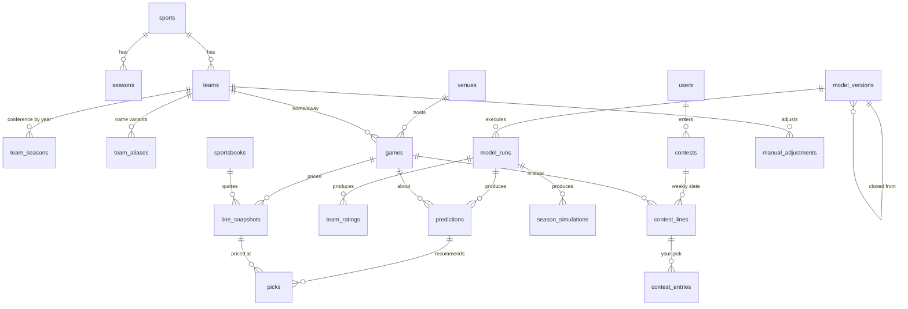

# 03 — Data Sources & Data Model

> Once Phase 0 begins, **the SQLAlchemy models and Alembic migrations in `python/db/` are the source of truth** for the schema. This doc describes the design intent; when they disagree, the code wins and this doc gets fixed.

## Data sources

### CollegeFootballData (CFBD): primary
REST API v2, base `https://api.collegefootballdata.com`, bearer API key. Official Python client: `cfbd`. Plan: Patreon tier 1 ($1/mo, 5,000 calls/month).

| Endpoint group | What we use it for | Granularity → calls |
|---|---|---|
| `/teams`, `/teams/fbs`, `/conferences`, `/venues` | Reference data, logos/colors, venue lat/lon/elevation/dome | ~1/season |
| `/games` | Schedule, results, neutral site, conference game flag, TBD kickoff flag | 1/season (+ weekly refresh in-season) |
| `/games/teams` | Traditional box scores by team-game | 1/week |
| `/stats/game/advanced` | Team-game PPA (CFBD's EPA), success rate, explosiveness, havoc, field position, rushing/passing splits, **garbage time filterable** | 1/season or 1/week |
| `/plays`, `/drives` | Play-by-play & drives (for our own EPA work, and drive-level simulation later) | 1/week |
| `/lines` | Spreads, totals and moneylines by provider, **incl. opening lines** | 1/season (+ daily in-season) |
| `/talent` | 247 team talent composite | 1/season |
| `/player/returning` | Returning production (% of PPA returning) | 1/season |
| `/recruiting/teams` | Recruiting class ratings | 1/season |
| `/ratings/sp`, `/ratings/fpi`, `/ratings/elo` | External ratings to **benchmark against** (not model inputs at first) | 1/season |
| `/ppa/predicted` | Expected-points curve, if we build our own EPA | once |
| `/calendar` | Week date boundaries | 1/season |
| `/scoreboard` | Live scores for the `scores` job (M6.8). **Tier 1: answers.** One counted call on 2026-10-23 (no params) returned 56 games, saved as `raw/cfbd/scoreboard/season=2026/fetched_at=2026-10-23T144734Z.parquet` (TASK-022) | once (tier check) |

**Backfill (2014–2026 to date, `engine backfill`, D-121):** each season is 14 season-level calls (`/games`, `/lines` and advanced stats per season type; `/calendar`, `/teams`, talent, returning production, recruiting, SP+, FPI, Elo) plus 3 a week (`/games/teams`, plays, drives) for 16–17 weeks, about 62–65; `/venues` and `/conferences` once. The dry run estimated 778 calls; the run on 2026-10-20 took **803** (16 regular weeks in some seasons, and 2024 week 5 after D-121's canceled-game rule), about 16% of the monthly allowance at tier 1. In-season steady state is about 30 calls/week from the scheduled jobs (TASK-022): `results` Sunday and Monday, 6 calls each for the week just played (`/games`, `/games/teams`, advanced stats, plays, drives, `/lines`), and `lines` daily plus Thursday and Friday evenings, 2 calls each (`/games` and `/lines` for the next week).

**Concept: PPA / EPA.** *Expected Points* is the average number of points a team scores from a given down, distance and field position (e.g. 1st-and-10 at the opponent's 25 is worth about 4 points). *EPA (Expected Points Added)*, which CFBD calls *PPA*, is the change in expected points caused by a play. A 30-yard completion on 3rd-and-8 might add +2.5. Averaging EPA per play measures efficiency independent of pace and garbage time. It's the single most predictive per-play statistic in football.

### Contest lines (Splash Sports first, any platform later)
A pick'em contest's lines can differ from the market's. Splash shows them on a webpage, and each game's line locks at its kickoff.
- **Import by paste:** you copy the contest page's text into the app, and a **per-platform parser** (Splash first) extracts teams and lines, matching teams through `team_aliases`. Unmatched rows are flagged for a one-time alias fix. Manual entry is the fallback, and other platforms get their own parser.
- **No automated scraping.** The page sits behind your login, and scraping it would likely break Splash's terms and break whenever their markup changes. Pasting is fast and robust.
- Lines can move until kickoff, so each paste is stored as a new **snapshot** and your entry records the line you actually got.

### NFL schedules and scores (for contest slates, Phase 4)
Splash slates mix college and NFL games. To store, display and grade NFL contest games before an NFL model exists (Phase 8), we ingest only the **NFL schedule, scores and closing lines from nflverse** (free CSVs), into the same `games` table under `sport_id = 'nfl'`. It's cheap, and it's the first real test of the multi-sport design.

### Weather: Open-Meteo (Phase 5)
Free forecast weather by lat/lon, keyed to `venues` (domes are skipped). Each fetch is stored as a **snapshot**, like lines, so a prediction can only use the forecast that existed before kickoff. Open-Meteo's *historical* data is observed weather, not what was forecast, so using it in a backtest would leak information the model couldn't have had. Backtests of the totals model must account for that.

### Injuries: no source
There's no free structured CFB injury feed, so the app doesn't ingest injuries. The user tracks them and enters the ones that matter as `manual_adjustments`.

### Later / optional
- **The Odds API**: multi-book live odds (`americanfootball_ncaaf`). Free tier: 500 credits/month, and a call costs markets × regions credits. Lower priority since you don't use a sportsbook.
- **nflverse** (NFL) and **CBBD** (college basketball) for other sports.

## Conventions

The core domain conventions (spread sign, margin, covering, week semantics, point-in-time) live in **[CLAUDE.md](../CLAUDE.md#domain-conventions)**, the single source. Data-specific rules on top of those:

- **Internal IDs** are our own surrogate keys, **assigned once and never derived from load order**. Every source entity keeps `source` + `source_id` (e.g. `cfbd`, `401628374`). Reference tables are **upserted by `(source, source_id)`, never truncated and reloaded**. A reload that renumbered games would silently repoint every contest entry and pick.
- **Team name matching** across sources ("Miami (FL)" vs "Miami", Splash's names vs CFBD's) goes through `team_aliases`.
- **Neutral-site games** still have a nominal "home" team (from the source). The `neutral_site` flag turns off home-field advantage.
- **Unknown is NULL, never a guess.** CFB kickoff times are often "TBA" for weeks. A game always has a `game_date`; `kickoff_at` is NULL until the time is announced. Never default it to midnight or `now()`.
- **Timestamps** are UTC `timestamptz`, and the UI converts to local time.
- **Never store derived data.** Pick results, records, ranks and CLV are views. The exception is model outputs (ratings, predictions), which SQL can't derive. Those are stored, immutably.
- **Soft delete** (`deleted_at`) for anything you create that has history hanging off it: contest entries, manual adjustments, lab models. Every read filters `deleted_at IS NULL`. Design UNIQUE constraints with re-adding in mind.
- **Catalog vs per-user:** "what exists" (games, picks the model made) and "what you did" (contest entries) live in separate tables keyed by `user_id`. No per-user columns on catalog tables.

## Lake layout (Parquet on R2 / local `./data`)

```
raw/        # exactly what the API returned, one file per pull, never modified
  cfbd/{endpoint}/season=2024/week=05/fetched_at=2024-10-01T120000Z.parquet
staging/    # cleaned, typed, deduped, "latest version" of each entity
  games.parquet, team_games.parquet, plays/season=YYYY/..., lines.parquet, ...
features/   # model-ready, point-in-time-safe tables
  team_week_features/  (one row per team, season, week = as-of state)
  game_features/       (one row per game: home vs away features + target)
backtests/  # walk-forward backtest runs and the holdout log, only ever added to
  <run>/predictions.parquet, <run>/run.json, holdout/<time>-<spec hash>.json
backups/    # nightly verified pg_dumps of the serving DB
```

**Raw files** (TASK-015, D-112, D-114): each pull is one Parquet file with one row per top-level record of the response. The columns are `row` (the record's position), `record` (the record as JSON text), `params` (the query sent, as JSON text) and `fetched_at` (UTC). Reading `record` back in `row` order gives exactly what the API returned, and an empty response is a zero-row file. Partitions are `season=Y[/season_type=postseason][/week=NN]`: regular-season files add no `season_type` level. `{endpoint}` is the endpoint's name in the registry, `python/engine/src/engine/ingest/endpoints.py` (e.g. `games_teams` for `/games/teams`). A game is **done** when CFBD marks it completed, or when it's unscored and its `/games` file was saved at least 7 days after its start (CFBD lists a canceled game, such as App State–Liberty 2024, as uncompleted forever). A week's file counts as final, and is never fetched again, only when it isn't empty and was saved after a `/games` file showed every game of that week done, that `/games` file itself saved at least 24 hours after the week's last kickoff: a Sunday-morning pull can miss plays, drives or box scores CFBD fills in later, so Monday's `results` run settles the week (TASK-022). A season-level file is final when a season `/games` file saved no later than it shows every game of its season type done (the postseason's, for an endpoint with no season type) and it was saved at least 7 days after that season type's last game, empty or not; a season `/games` file needs only itself (TASK-021, D-121). The CFBD call ledger, `cfbd_calls.json`, sits at the lake root beside `raw/`, so it moves to R2 with the lake.

**Staged tables** (TASK-017, D-116): `engine transform --rebuild` rebuilds every table from `raw/` with no API calls, then runs the data-quality checks; `engine check` runs the checks alone. Each table is one file, `staging/<table>.parquet`, overwritten on every rebuild (staging is derived; raw never is). An entity's row comes from its record in the newest pull (`fetched_at`) across the endpoint's week and season files; a raw file whose `params` disagree with its key is skipped and listed in `skipped_raw`. The registry is `engine/transform/__init__.py` › `TABLES`.

| Table | One row per | Columns |
|---|---|---|
| `games` | CFBD game (`/games`) | `source_id`, `season`, `week`, `season_type`, `game_date` (Eastern), `kickoff_at` (NULL when TBA), `neutral_site`, `conference_game`, `venue_source_id`, `home_source_id`, `away_source_id`, `home_points`, `away_points`, `status` (`final`/`scheduled`), `home_classification`, `away_classification`, `fetched_at`, `closing_line_missing` |
| `teams` | team (`/teams`, else `/games`) | `source_id`, `school`, `mascot`, `abbreviation`, `color`, `alt_color`, `logo_url`, `fetched_at` |
| `team_seasons` | team and season | `team_source_id`, `season`, `conference`, `classification` (fbs/fcs: Postgres `team_seasons.division`), `cfbd_division` (CFBD's own, e.g. East/West), `fetched_at` |
| `venues` | venue (`/venues`, else `/games`) | `source_id`, `name`, `city`, `state`, `lat`, `lon`, `elevation` (meters, e.g. Lawrence 274.9; published as `venues.elevation_m`), `dome`, `grass`, `timezone`, `capacity`, `fetched_at` |
| `calendar` | season, season type and week (`/calendar`) | `season`, `season_type`, `week`, `start_at`, `end_at`, `first_game_start`, `last_game_start`, `fetched_at` |
| `lines` | game, provider and pull (`/lines`; every pull is kept) | `game_source_id`, `provider`, `fetched_at`, `spread_home`, `spread_home_open`, `total`, `total_open`, `ml_home`, `ml_away` |
| `team_games` | game and team (`/games/teams` box score) | `game_source_id`, `team_source_id`, `team`, `conference`, `home_away`, `points`, `stats` (CFBD's category → stat as JSON text, as sent, e.g. `"completionAttempts": "23-31"`), `fetched_at` |
| `team_game_advanced` | game and team (`/stats/game/advanced`) | `game_source_id`, `team_source_id`, `team`, `opponent`, `season`, `week`, `season_type`, `garbage_time_excluded`, then for the team's offense (`off_`) and defense (`def_`): `plays`, `ppa`, `success_rate`, `explosiveness`, `power_success`, `stuff_rate`, `line_yards`, `rush_ppa`, `rush_success_rate`, `rush_explosiveness`, `pass_ppa`, `pass_success_rate`, `pass_explosiveness`; `fetched_at` |
| `talent` | season and team (`/talent`) | `season`, `team_source_id`, `team`, `talent`, `fetched_at` |
| `returning_production` | season and team (`/player/returning`) | `season`, `team_source_id`, `team`, `conference`, `total_ppa`, `total_passing_ppa`, `total_receiving_ppa`, `total_rushing_ppa`, `percent_ppa`, `percent_passing_ppa`, `percent_receiving_ppa`, `percent_rushing_ppa`, `usage`, `passing_usage`, `receiving_usage`, `rushing_usage`, `fetched_at` |
| `recruiting` | season and team (`/recruiting/teams`) | `season`, `team_source_id`, `team`, `rank`, `points`, `fetched_at` |
| `benchmark_ratings` | system, season, team and pull (`/ratings/sp`, `/ratings/fpi`, `/ratings/elo`; every pull is kept) | `system` (`sp`/`fpi`/`elo`), `season`, `team_source_id`, `team`, `conference`, `rating`, `fetched_at`, `season_final`, `known_at` |
| `skipped_raw` | raw file left out | `key`, `reason` |

**Season tables** (TASK-018, D-119): `plays` and `drives` are too big to rebuild every season in memory at once, so each season is built and written on its own, to `staging/{plays,drives}/season=YYYY/data.parquet` (registry: `SEASON_TABLES`), before `skipped_raw` so a skipped play or drive file is listed too. Each game's rows come from the newest pull that has the game, never merged across pulls (a later pull can drop a play or renumber drives). Season, week and season type come from the raw file's key. Season files are replaced before the other tables are written, so a rebuild that fails part-way must be rerun (D-119 amends D-116 here).

| Table | One row per | Columns |
|---|---|---|
| `plays` | play (`/plays`) | `game_source_id`, `play_id`, `drive_id`, `season`, `week`, `season_type`, `drive_number`, `play_number`, `period`, `clock_seconds`, `offense`, `offense_source_id`, `defense`, `defense_source_id`, `offense_score`, `defense_score`, `yardline`, `yards_to_goal`, `down`, `distance`, `yards_gained`, `scoring`, `play_type`, `play_text`, `ppa`, `wallclock`, `fetched_at` |
| `drives` | drive (`/drives`) | `game_source_id`, `drive_id`, `season`, `week`, `season_type`, `drive_number`, `offense`, `offense_source_id`, `defense`, `defense_source_id`, `is_home_offense`, `scoring`, `drive_result`, `plays`, `yards`, `start_period`, `start_yards_to_goal`, `start_clock_seconds`, `end_period`, `end_yards_to_goal`, `end_clock_seconds`, `elapsed_seconds`, `start_offense_score`, `start_defense_score`, `end_offense_score`, `end_defense_score`, `fetched_at` |

**Team ids by name** (D-119): `/games/teams` gives team ids; advanced stats, plays and drives name teams, so their ids come from the game's home and away names in its newest `/games` record (advanced stats fall back to the opponent's name and dedupe on the resolved id, so a school renamed between pulls stays one row), and the season endpoints' from staged `teams.school` (a school two teams share matches neither). A name that doesn't match stays NULL, and the rebuild lists it. **Garbage time:** only the excluded variant of `/stats/game/advanced` is pulled (`excludeGarbageTime=true` is fixed in the registry); `garbage_time_excluded` is read from each pull's `params`. Like `lines`, `team_game_advanced` keeps only games in staged `games` (the endpoint takes no `classification`) and the rebuild prints how many rows it dropped. **Benchmarks:** `season_final` is true when the pull came at or after the end of the season's last staged `calendar` week, false before it, and NULL when the season has no calendar; `known_at` is `fetched_at` for a pull before the season's end and NULL otherwise. A baseline (M3.4) may read only rows with `known_at` before kickoff; the rest are hindsight benchmarks ([04 § 9.2](04-model.md)). SP+'s `nationalAverages` row is dropped.

`lines` keeps only games in staged `games`: CFBD's `/lines` takes no `classification`, so a week's pull includes games with no FBS team, and the rebuild prints how many rows it dropped. `games.closing_line_missing` is `false` when a non-empty `/lines` pull fetched after kickoff quotes a spread for the game, `true` when such a pull covers the game's season and week but quotes none, and NULL when no post-kickoff pull covers it. An empty pull isn't coverage (CFBD can answer empty just after the games, D-114), and a TBA kickoff counts as the end of its Eastern `game_date`. The flag is a staging fact for the check, not a Postgres column (hard rule 1).

DuckDB SQL builds `staging/` and `features/` from `raw/`, so it's fully reproducible. The point-in-time rule is enforced in `features/`: a `team_week_features` row for week N aggregates only games that finished before `as_of`.

**Feature tables** (TASK-019, D-127): `engine transform --rebuild` builds them from staged `games` and `team_game_advanced` after staging, one file each, `features/{team_week_features,game_features}.parquet` (registry: `FEATURE_TABLES`). A week's `as_of` is its earliest staged kickoff (a TBA game counts as the start of its Eastern date). A team's row aggregates its `final` games that season that finished before `as_of`, a game counting as finished 4 hours after kickoff (a TBA game kicks off at the end of its date); the cutoff is a time, so postseason week 1 comes after the regular season. Every team in the season's staged games gets a row for every week with a staged game; week-1 rows have counts and sums 0 and means NULL. Rates are means of per-game values. A team-game with no advanced-stats row (D-121) counts in games and points but not in the rate means. The rebuild fails, naming the team, season and week, if any row's newest source game didn't finish before its `as_of`, or a row has no `as_of`.

| Table | One row per | Columns |
|---|---|---|
| `team_week_features` | team, season, season type and week (the team entering that week) | `team_source_id`, `season`, `season_type`, `week`, `as_of`, `last_game_kickoff` (the newest game counted), `games_played`, `points_for`, `points_against` (sums), `points_for_per_game`, `points_against_per_game`, `margin_per_game`, `advanced_games` (games with an advanced-stats row; a rate's mean skips a game whose value is NULL), `off_plays`, `def_plays` (sums), then the means `{off,def}_{ppa,success_rate,explosiveness}` and the same with `rush_` and `pass_` before the metric (e.g. `def_pass_success_rate`) |
| `game_features` | staged game | `game_source_id`, `season`, `season_type`, `week`, `as_of`, `kickoff_at`, `neutral_site`, `home_source_id`, `away_source_id`, every `team_week_features` column from `last_game_kickoff` on as `home_<column>` and `away_<column>` (NULL for a side with no team id), and the target `margin` (`home_points − away_points`, NULL until final) |

**Backtests** (TASK-030, D-131): `engine backtest` reads `staging/` and `features/` and writes each run to a new folder, `backtests/<UTC time>-<first 12 hex of the spec hash>/` (with `-2`, `-3` … if that name is taken): `predictions.parquet` (below) and `run.json` (`created_at`, the spec and its sha256 hash, the model, the scored seasons, `tune_from`, whether it opened the holdout, the settings chosen for each season and the seasons they were tuned on, and the number of games). The predictions hold nothing about when they ran, so a re-run of the same spec on the same lake is byte-identical. A run that scores a holdout season adds one record to `backtests/holdout/` first (time, spec hash, seasons, reason, model), so the Lab can count how often the holdout has been opened (04 § 6). These move to `model_runs` once it exists (planned: TASK-034 and later).

| File | One row per | Columns |
|---|---|---|
| `predictions.parquet` | eligible game of a scored season (FBS vs FBS, final, with a closing line), in (season, `as_of`, season type, week, `game_source_id` as text) order | `season`, `season_type`, `week`, `as_of` (the week's), `game_source_id`, `kickoff_at` (NULL when TBA), `home_source_id`, `away_source_id`, `neutral_site`, `pred_margin`, `margin_sd`, `home_win_prob`, `spread_home` (the closing line, `engine.transform.market.closing_lines()`), `spread_home_open` and `spread_home_open_close` (the opener and the close of the books that quoted both, each consensus-else-median, for CLV; NULL when no book did; TASK-031, D-132), `spread_source` (`consensus` or `median`), `closing_from` (`cfbd_close` or `last_snapshot`), `home_points`, `away_points`, `margin` |

## Serving database (Postgres) schema

Types are abbreviated. Every table that isn't a pure lookup gets `created_at`.



### Reference
**sports**: `id text PK ('cfb','nfl')`, `name`

**seasons**: `sport_id`, `year`, `source`, `start_date`, `end_date`, `current_week NULL`, `weeks jsonb`, `updated_at` · PK `(sport_id, year)` · CHECK `weeks` is an array, `end_date >= start_date`. `weeks` is CFBD `/calendar` as `[{"week": 6, "season_type": "regular", "start": "<UTC ISO>", "end": "<UTC ISO>"}, …]` (TASK-016). Each publish sets `current_week` to the regular-season week whose span contains the publish time, else NULL, so the daily `lines` job keeps it within a day (TASK-020).

**teams**: `id PK`, `sport_id`, `source`, `source_id`, `school`, `mascot`, `abbreviation`, `color`, `alt_color`, `logo_url` · UQ `(sport_id, source, source_id)`

**team_seasons**: `team_id`, `season`, `conference`, `division` (`fbs`/`fcs`/…), `talent`, `returning_ppa_pct` · PK `(team_id, season)`. *Conference realignment means conference is a per-season fact, not a team attribute.*

**team_aliases**: `id PK`, `team_id`, `source` (whose spelling: `cfbd`, `splash`, `manual`, `fixture`, …; no CHECK, since each new platform adds one), `alias` · UQ `(source, alias)` · IDX `(team_id)`

**venues**: `id PK`, `source`, `source_id`, `name`, `city`, `state`, `lat`, `lon`, `elevation_m`, `dome bool`, `grass bool`, `timezone`, `capacity`

### Games & market
**games**: `id PK`, `sport_id`, `source`, `source_id`, `season`, `week`, `season_type`, `game_date date NOT NULL`, `kickoff_at timestamptz NULL`, `neutral_site`, `conference_game`, `venue_id`, `home_team_id`, `away_team_id`, `home_points`, `away_points`, `status` (`scheduled|in_progress|final|canceled|postponed`), `updated_at`
UQ `(sport_id, source, source_id)` · IDX `(sport_id, season, week)` · CHECK final ⇒ points not null

**sportsbooks**: `id PK`, `source`, `source_id` (the provider as that source writes it, e.g. CFBD's `consensus`, `DraftKings`), `name` · UQ `(source, source_id)`. Matching one book across sources waits for a second line source (TASK-016).

**line_snapshots**: append-only price history (D-037, D-115)
`id PK`, `game_id`, `book_id`, `source` (`cfbd|oddsapi|manual|fixture`), `kind` (`opening|closing|snapshot`), `captured_at timestamptz NULL`, `spread_home numeric(4,1)`, `total numeric(4,1)`, `spread_home_price`, `spread_away_price`, `over_price`, `under_price`, `ml_home`, `ml_away` (prices are `int`; any of them NULL when not quoted)
UQ `(game_id, book_id, source, kind, captured_at)` NULLS NOT DISTINCT · IDX `(game_id, captured_at)` · CHECK `kind = 'snapshot'` ⇒ `captured_at` not null · triggers refuse UPDATE, DELETE and TRUNCATE
*CFBD's historical open and close are `opening` and `closing` rows with `captured_at` NULL, because CFBD doesn't say when either was quoted (D-031). `engine publish` maps each staged `/lines` pull by its time against the game's cutoff (`kickoff_at`, or the end of `game_date` in Eastern time when the kickoff is TBA): a pull before the cutoff is a `snapshot` at its `fetched_at`; the first pull at or after it is the untimed `closing` row; the first pull with an open (`spreadOpen` or `overUnderOpen`) writes the untimed `opening` row; a row with no spread, total or moneyline is skipped. The key keeps an untimed row's first value, so re-publishing inserts nothing (`ON CONFLICT DO NOTHING`) and a later, different open stays only in the lake (TASK-020, D-120).*

### Models & outputs
**model_versions**: `id PK`, `sport_id`, `name` (`power-v1`, or your own name), `version`, `description`, `spec jsonb` (a validated `ModelSpec`: inputs, hyperparameters, fixed-or-fitted weights, pick rules), `spec_schema_version`, `parent_version_id NULL` (cloned from), `created_by` (`system|user`), `code_sha`, `status` (`dev|candidate|production|retired`), `created_at`, `deleted_at`
*Only one `production` version per sport per market (partial unique index).*

**model_runs**: `id PK`, `model_version_id`, `run_type` (`backtest|scheduled|adhoc`), `season`, `week`, `as_of`, `status` (`queued|running|succeeded|failed`), `requested_at`, `started_at`, `finished_at`, `github_run_id`, `fitted_params jsonb` (**the learned weights**, e.g. points per EPA, HFA, prior decay, which the "View weights" screen reads), `metrics jsonb` (backtest summary), `error`

**team_ratings**: `model_run_id`, `model_version_id`, `team_id`, `season`, `week`, `as_of`, `rating`, `off_rating`, `def_rating`, `st_rating`, `prior_weight` (how much is still preseason prior), `components jsonb` (rush/pass splits, success rate, explosiveness…)
PK `(model_version_id, team_id, season, week)`. *Rank is a view (window function), not a column.*

**predictions**: immutable; a new row each time it's re-predicted
`id PK`, `model_run_id`, `model_version_id`, `game_id`, `created_at`, `pred_margin` (home − away), `pred_total`, `home_win_prob`, `margin_sd`, `drivers jsonb` (top contributions for "why"), `adjustments_applied jsonb`
IDX `(game_id, model_version_id, created_at DESC)`

**picks**: immutable recommendation locked to a specific price
`id PK`, `prediction_id`, `line_snapshot_id NULL`, `contest_line_id NULL` (exactly one is set), `market` (`spread|total|moneyline`), `side` (`home|away|over|under`), `line`, `price NULL` (null for no-vig contest picks), `model_prob`, `edge_pts`, `expected_value`, `tier` (`A|B|C`), `stake_units`, `created_at`
*The current pick for a game is the latest one per (game, model version, market, line source). No `superseded_by` column, since that would be derived.*

**season_simulations**: `model_run_id`, `team_id`, `season`, `week`, `n_sims`, `exp_wins`, `win_distribution jsonb` (P(0..N wins)), `p_conf_title_game`, `p_conf_title`, `p_playoff NULL`, `p_title NULL` (CFP columns stay null until the selection model exists)

### Your data
**users**: `id PK`, `github_id`, `email`, `name`, `created_at`

**contests**: `id PK`, `user_id`, `name` ("Work league"), `platform` (`splash|manual|…`), `season`, `rules jsonb` (validated `ContestRules`, below), `created_at`, `deleted_at`

`ContestRules` (pydantic; the Splash preset in brackets):
| Field | Meaning | Splash preset |
|---|---|---|
| `period` | `week` (later `day` for other sports) | `week` |
| `sports` | which sports' games are eligible | `[cfb, nfl]` |
| `slate` | `all_games` or `curated` (only the games the contest lists) | `curated` (whatever the page shows) |
| `picks_per_period` | exact, or min/max | exactly 4 |
| `lock` | `per_game_kickoff` or `fixed_time` | `per_game_kickoff` |
| `scoring` | `point_per_win`, `confidence`, … | `point_per_win` |
| `push` | `zero`, `half`, `void` | `zero` (confirm) |

**contest_lines**: append-only snapshots of the contest's slate and lines. `id PK`, `contest_id`, `period` (season week), `game_id`, `spread_home`, `captured_at`, `source` (`paste|manual`) · IDX `(contest_id, game_id, captured_at DESC)`. *The current contest line is the latest snapshot (a view).*

**contest_entries**: your actual picks. `id PK`, `user_id`, `contest_id`, `contest_line_id` (the exact snapshot you picked at), `side`, `confidence NULL`, `created_at`, `deleted_at`. *Lock is enforced in the API: no entries or changes after the game's `kickoff_at` (or the contest's fixed time).*

**manual_adjustments**: `id PK`, `sport_id`, `team_id`, `game_id NULL` (null means applies to all games in the window), `points` (+/−, rating units), `unit` (`overall|off|def`), `reason`, `active_from`, `active_to NULL`, `created_by`, `created_at`, `deleted_at`. *Predictions record which adjustments they used, so the track record shows adjusted vs pure-model results.*

**bets** (Later, only if you start betting at a sportsbook): same shape as `contest_entries` plus book, price and stake.

### Views (derived data lives here)
| View | What it computes |
|---|---|
| `game_market` | One row per game: opening, current and closing `*_spread_home`, `*_total`, `*_source` and `*_captured_at`. Each line is one pull (rows with the same kind and `captured_at`), priced from the `consensus` book when it quoted that price, else the median across the pull's books; `*_source` (`consensus`/`median`) says which for the spread. Opening is the untimed `opening` rows, else the earliest snapshot. Current is the newest snapshot, else the closing, else the opening. Closing is CFBD's untimed `closing` rows when present, else the last snapshot before kickoff (or before the end of `game_date` in Eastern time when the kickoff time is unknown), and NULL until that cutoff has passed; `closing_from` (`cfbd_close`/`last_snapshot`) says which (TASK-020, D-120) |
| `team_rankings` | Rank and week-over-week rank change from `team_ratings` |
| `team_schedule_strength` | Per team, season and week: SOS, the average rating entering that week of the opponents already played, adjusted for site, and its rank. The Rankings SOS column and the team page's "34th SOS rank" read it ([04 § 10.5](04-model.md); planned: M3.7) |
| `current_picks` | Latest pick per (game, model version, market, line source) |
| `pick_outcomes` | Per pick: result (`won|lost|push|void|pending`) from final scores, closing line, CLV in points |
| `model_record` | Rollups by model version / season / week / tier / edge bucket: W-L-P, win %, units, ROI, avg CLV |
| `current_contest_lines` | Latest contest line per (contest, game), next to the consensus market line and the model line |
| `contest_results` | Your entries graded against the line you picked at (using the contest's push rule); weekly and season record. The same grading also runs on the model's top-N recommendations, so you can compare yourself with the model |

Views are re-applied after every migration (dev rebuild, preview build, and release). Each gets a test, and views read for one item filter by that item before aggregating (a test checks `EXPLAIN` for full-table scans).

### Phase 5: watchlist, alerts & weather (proposed, not approved)
Rough shape, to be proposed and reviewed before any migration:
- **watchlist**: a user's starred games, with what to alert on (edge crosses the pick threshold; line moves by at least N points). Soft-deleted like other user data.
- **alert log**: one row per alert sent (game, kind, the line snapshot that triggered it, sent at), so the `lines` job never sends the same alert twice.
- **weather snapshots**: append-only per (game, captured at): forecast time, temperature, wind, gusts, precipitation chance and amount. The flag itself ("windy", "rain") is derived in a view, so the thresholds can change without rewriting rows.

Line movement, the best lines board and this week's record need no new tables: they read `line_snapshots`, `game_market`, `current_contest_lines`, `pick_outcomes` and `contest_results`.

### Proposed additions from the design handoff (2026-10-07, not approved)

The handoff shows data that no table above holds. Like the Phase 5 and Phase 6 proposals, this is a rough shape to review before any migration (CLAUDE.md: schema changes need approval first). Feature and screen IDs: [01 › Feature index](01-product.md#feature-index-ids-priorities-outcomes), [05 › Screen inventory](05-ui-design-brief.md#screen-inventory-from-handoff).

**Needed for the MVP (Phase 4)**
- **user_settings** (F-45, S-13): one row per `user_id` holding `theme` (`dark|light|system`), `time_zone` (IANA name; NULL = use the device's zone), and `default_contest_id NULL`. It's per-user data, so it gets its own table rather than columns on `users`.
- **contest_standings** (F-33, S-02 Results & standing): the league standing you enter by hand. `id PK`, `contest_id`, `period` (season week), `position` (e.g. 3), `field_size` (e.g. 14), `points_behind_leader NULL`, `note NULL`, `entered_at`. Append-only; the current standing is the latest row per contest, read through a view.

**Needed with watchlist & alerts (Phase 5), extending the proposal above**
- **alert_rules** (F-14, S-12): `user_id`, `kind` (`edge_crossed|line_moved`), `scope` (`all|starred`), `threshold_pts NULL` (line moves only, in half-point steps, default 1.0), `enabled`. Defaults follow D-082: edge_crossed on all games, line_moved ≥ 1.0 on starred games.
- **Alert delivery** (`email|push`) is a column on `user_settings`.
- **The alert log** gains `read_at NULL`, which drives the bell's unread badge.
- **push_subscriptions** (only if push delivery is built): `user_id`, `endpoint`, `keys jsonb`, `created_at`, `deleted_at`.

**Not stored in Postgres**
- ⌘K recent teams (S-14) are a per-device convenience, kept in browser storage.
- Sign-in has no password or lockout data; GitHub OAuth only (D-078).

**Fixture rows:** every `source` column must accept `'fixture'` for the test seed (D-089). The seed refuses non-test databases, so production never holds that value.

### Proposed additions for ratings depth (2026-10-20, not approved)

For F-46 to F-49 in Phase 5 ([04 § 10](04-model.md), [02 › Ratings depth](02-architecture.md#ratings-depth-units-schedule-strength-and-team-stats-added-2026-10-20)). A rough shape, reviewed at each schema task's plan gate before any migration.
- **team_game_stats** (M18.5): one row per (game, team) with the catalog's per-game metrics for offense and defense: box score, CFBD advanced (garbage time excluded) and our PBP-derived ones, with a flag saying which are garbage-time filtered. Facts, so upserted by the game's source key and rebuilt from the lake like `games` (hard rule 3). Wide columns or one `jsonb` is decided at the plan gate.
- **Views over it:** season-to-date stats per team entering each week, and opponent-removed stats (each opponent's numbers with its games against the team taken out). Records and ranks stay views too.
- **Unit ratings** need no change: they go in `team_ratings.components` (keyed by input-registry id) and `st_rating`.
- **Schedule strength outputs** (M18.4): per model run, team, season and week: `sor`, `sor_benchmark_rating` (the 25th-best rating it was measured against), `sos_remaining`, `sos_full`. Model outputs, insert-only and tied to `model_run_id` like `season_simulations`. Its own table or columns on `team_ratings` is decided at the plan gate.
- **Not stored:** confidence levels (computed from `picks.model_prob` and the spec's cutoffs), the conference-tier map (code in `sports/cfb`), and the input registry (code in `engine.core`).

### Later: history & coaches (proposed, not approved)
Phase 6 ([04-model.md §7](04-model.md)) will need a way to mark a rating as *predictive* or *hindsight* (so predictions can never read hindsight ratings), plus `coaches` and `coach_tenures` with game-level attribution for mid-season changes. Program and coach rankings themselves are views. The exact schema is proposed and reviewed at the start of Phase 6.

### Sizing sanity check
About 3,800 games/season including FCS × 13 seasons comes to roughly 50k games. Line snapshots run around 10 per game, so ~500k rows. Ratings: ~260 teams × 17 weeks × 13 seasons × a few model versions ≈ 200k rows. Altogether that's **well under 100 MB**, comfortably inside Neon's 0.5 GB. Lab experiments add more ratings and predictions, so we'll prune old `dev`-status backtest runs if needed.

## Data quality checks (run after each ingest)
`engine check` (and `engine transform --rebuild`, after staging) runs the checks built so far (`engine/transform/quality.py` › `CHECKS`, D-116). It prints each failure with the offending game's `source_id` and each note, and exits 1 when any check fails; publishing refuses on a failed report.
- Every final game has scores (`final_has_score`).
- Every FBS team in a final game has a `team_game_advanced` row (`advanced_stats`, D-119). A missing one fails in a backtest season (2014–2025), or once advanced stats fetched after kickoff cover the game's week; before that (the live season before its stats pull) it's listed as a note. When a pull fetched 7+ days after kickoff covers the week without it, CFBD has none (103 team-games in 2014–2025, mostly 2014–2016 games with missing or partial play-by-play), and it's a note too; more of those in 2014–2025 than the 103 known fails the check, as a staging regression or new CFBD gaps (D-121).
- Every final FBS-vs-FBS game in a backtest season (2014–2025) has a closing line, or is explicitly flagged as missing (`closing_line`: `closing_line_missing` true is listed as a note, NULL fails).
- No duplicate games: the same two teams, either way round, on the same Eastern date (`no_duplicate_games`).
- Raw files skipped because their `params` don't match their key are listed as notes (`raw_files`).
- Team mapping coverage: 100% of non-CFBD names (Splash, Odds API) resolve to a team.
- Feature tables pass the "no future data" assertion: max source game time < `as_of`. `engine transform --rebuild` asserts it as it builds them and exits 1 before replacing any feature file or any staged file except the `plays` and `drives` season files, which are already written (D-119) (`features.check_point_in_time`, D-127).
