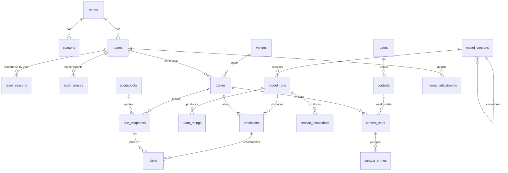

# 03 — Data Sources & Data Model

> Once Phase 0 begins, **the SQLAlchemy models and Alembic migrations in `python/db/` are the source of truth** for the schema. This doc describes the design intent; when they disagree, the code wins and this doc gets fixed.

## Data sources

### CollegeFootballData (CFBD): primary
REST API v2, base `https://api.collegefootballdata.com`, bearer API key. Official Python client: `cfbd`. Plan: Patreon tier 1 ($1/mo, 5,000 calls/month).

| Endpoint group | What we use it for | Granularity → calls |
|---|---|---|
| `/teams`, `/teams/fbs`, `/conferences`, `/venues` | Reference data, logos/colors, venue lat/lon/elevation/dome | ~1/season |
| `/games` | Schedule, results, neutral site, conference game flag, TBD kickoff flag | 1/season (+ weekly refresh in-season) |
| `/games/teams` | Traditional box scores by team-game | 1/week |
| `/stats/game/advanced` | Team-game PPA (CFBD's EPA), success rate, explosiveness, havoc, field position, rushing/passing splits, **garbage time filterable** | 1/season or 1/week |
| `/plays`, `/drives` | Play-by-play & drives (for our own EPA work, and drive-level simulation later) | 1/week |
| `/lines` | Spreads, totals and moneylines by provider, **incl. opening lines** | 1/season (+ daily in-season) |
| `/talent` | 247 team talent composite | 1/season |
| `/player/returning` | Returning production (% of PPA returning) | 1/season |
| `/recruiting/teams` | Recruiting class ratings | 1/season |
| `/ratings/sp`, `/ratings/fpi`, `/ratings/elo` | External ratings to **benchmark against** (not model inputs at first) | 1/season |
| `/ppa/predicted` | Expected-points curve, if we build our own EPA | once |
| `/calendar` | Week date boundaries | 1/season |

**Backfill budget (2014–2025, 12 seasons):** season-level endpoints run about 12 × 10 = 120 calls, and weekly PBP/drives about 12 × 16 × 2 = 384 calls. That's roughly **500 calls**, about 10% of the monthly allowance at tier 1. In-season steady state is about 20–40 calls/week.

**Concept: PPA / EPA.** *Expected Points* is the average number of points a team scores from a given down, distance and field position (e.g. 1st-and-10 at the opponent's 25 is worth about 4 points). *EPA (Expected Points Added)*, which CFBD calls *PPA*, is the change in expected points caused by a play. A 30-yard completion on 3rd-and-8 might add +2.5. Averaging EPA per play measures efficiency independent of pace and garbage time. It's the single most predictive per-play statistic in football.

### Contest lines (Splash Sports first, any platform later)
A pick'em contest's lines can differ from the market's. Splash shows them on a webpage, and each game's line locks at its kickoff.
- **Import by paste:** you copy the contest page's text into the app, and a **per-platform parser** (Splash first) extracts teams and lines, matching teams through `team_aliases`. Unmatched rows are flagged for a one-time alias fix. Manual entry is the fallback, and other platforms get their own parser.
- **No automated scraping.** The page sits behind your login, and scraping it would likely break Splash's terms and break whenever their markup changes. Pasting is fast and robust.
- Lines can move until kickoff, so each paste is stored as a new **snapshot** and your entry records the line you actually got.

### NFL schedules and scores (for contest slates, Phase 4)
Splash slates mix college and NFL games. To store, display and grade NFL contest games before an NFL model exists (Phase 8), we ingest only the **NFL schedule, scores and closing lines from nflverse** (free CSVs), into the same `games` table under `sport_id = 'nfl'`. It's cheap, and it's the first real test of the multi-sport design.

### Weather: Open-Meteo (Phase 5)
Free forecast weather by lat/lon, keyed to `venues` (domes are skipped). Each fetch is stored as a **snapshot**, like lines, so a prediction can only use the forecast that existed before kickoff. Open-Meteo's *historical* data is observed weather, not what was forecast, so using it in a backtest would leak information the model couldn't have had. Backtests of the totals model must account for that.

### Injuries: no source
There's no free structured CFB injury feed, so the app doesn't ingest injuries. The user tracks them and enters the ones that matter as `manual_adjustments`.

### Later / optional
- **The Odds API**: multi-book live odds (`americanfootball_ncaaf`). Free tier: 500 credits/month, and a call costs markets × regions credits. Lower priority since you don't use a sportsbook.
- **nflverse** (NFL) and **CBBD** (college basketball) for other sports.

## Conventions

The core domain conventions (spread sign, margin, covering, week semantics, point-in-time) live in **[CLAUDE.md](../CLAUDE.md#domain-conventions)**, the single source. Data-specific rules on top of those:

- **Internal IDs** are our own surrogate keys, **assigned once and never derived from load order**. Every source entity keeps `source` + `source_id` (e.g. `cfbd`, `401628374`). Reference tables are **upserted by `(source, source_id)`, never truncated and reloaded**. A reload that renumbered games would silently repoint every contest entry and pick.
- **Team name matching** across sources ("Miami (FL)" vs "Miami", Splash's names vs CFBD's) goes through `team_aliases`.
- **Neutral-site games** still have a nominal "home" team (from the source). The `neutral_site` flag turns off home-field advantage.
- **Unknown is NULL, never a guess.** CFB kickoff times are often "TBA" for weeks. A game always has a `game_date`; `kickoff_at` is NULL until the time is announced. Never default it to midnight or `now()`.
- **Timestamps** are UTC `timestamptz`, and the UI converts to local time.
- **Never store derived data.** Pick results, records, ranks and CLV are views. The exception is model outputs (ratings, predictions), which SQL can't derive. Those are stored, immutably.
- **Soft delete** (`deleted_at`) for anything you create that has history hanging off it: contest entries, manual adjustments, lab models. Every read filters `deleted_at IS NULL`. Design UNIQUE constraints with re-adding in mind.
- **Catalog vs per-user:** "what exists" (games, picks the model made) and "what you did" (contest entries) live in separate tables keyed by `user_id`. No per-user columns on catalog tables.

## Lake layout (Parquet on R2 / local `./data`)

```
raw/        # exactly what the API returned, one file per pull, never modified
  cfbd/{endpoint}/season=2024/week=05/fetched_at=2024-10-01T120000Z.parquet
staging/    # cleaned, typed, deduped, "latest version" of each entity
  games.parquet, team_games.parquet, plays/season=YYYY/..., lines.parquet, ...
features/   # model-ready, point-in-time-safe tables
  team_week_features/  (one row per team, season, week = as-of state)
  game_features/       (one row per game: home vs away features + target)
backups/    # nightly verified pg_dumps of the serving DB
```

**Raw files** (TASK-015, D-112, D-114): each pull is one Parquet file with one row per top-level record of the response. The columns are `row` (the record's position), `record` (the record as JSON text), `params` (the query sent, as JSON text) and `fetched_at` (UTC). Reading `record` back in `row` order gives exactly what the API returned, and an empty response is a zero-row file. Partitions are `season=Y[/season_type=postseason][/week=NN]`: regular-season files add no `season_type` level. `{endpoint}` is the endpoint's name in the registry, `python/engine/src/engine/ingest/endpoints.py` (e.g. `games_teams` for `/games/teams`). A week's file counts as final, and is never fetched again, only when it isn't empty and was saved after a `/games` file showed every game of that week completed. The CFBD call ledger, `cfbd_calls.json`, sits at the lake root beside `raw/`, so it moves to R2 with the lake.

DuckDB SQL builds `staging/` and `features/` from `raw/`, so it's fully reproducible. The point-in-time rule is enforced in `features/`: a `team_week_features` row for week N aggregates only games with `week < N` (or kickoff before `as_of`).

## Serving database (Postgres) schema

Types are abbreviated. Every table that isn't a pure lookup gets `created_at`.



### Reference
**sports**: `id text PK ('cfb','nfl')`, `name`

**seasons**: `sport_id`, `year`, `source`, `start_date`, `end_date`, `current_week NULL`, `weeks jsonb`, `updated_at` · PK `(sport_id, year)` · CHECK `weeks` is an array, `end_date >= start_date`. `weeks` is CFBD `/calendar` as `[{"week": 6, "season_type": "regular", "start": "<UTC ISO>", "end": "<UTC ISO>"}, …]` (TASK-016).

**teams**: `id PK`, `sport_id`, `source`, `source_id`, `school`, `mascot`, `abbreviation`, `color`, `alt_color`, `logo_url` · UQ `(sport_id, source, source_id)`

**team_seasons**: `team_id`, `season`, `conference`, `division` (`fbs`/`fcs`/…), `talent`, `returning_ppa_pct` · PK `(team_id, season)`. *Conference realignment means conference is a per-season fact, not a team attribute.*

**team_aliases**: `id PK`, `team_id`, `source` (whose spelling: `cfbd`, `splash`, `manual`, `fixture`, …; no CHECK, since each new platform adds one), `alias` · UQ `(source, alias)` · IDX `(team_id)`

**venues**: `id PK`, `source`, `source_id`, `name`, `city`, `state`, `lat`, `lon`, `elevation_m`, `dome bool`, `grass bool`, `timezone`, `capacity`

### Games & market
**games**: `id PK`, `sport_id`, `source`, `source_id`, `season`, `week`, `season_type`, `game_date date NOT NULL`, `kickoff_at timestamptz NULL`, `neutral_site`, `conference_game`, `venue_id`, `home_team_id`, `away_team_id`, `home_points`, `away_points`, `status` (`scheduled|in_progress|final|canceled|postponed`), `updated_at`
UQ `(sport_id, source, source_id)` · IDX `(sport_id, season, week)` · CHECK final ⇒ points not null

**sportsbooks**: `id PK`, `source`, `source_id` (the provider as that source writes it, e.g. CFBD's `consensus`, `DraftKings`), `name` · UQ `(source, source_id)`. Matching one book across sources waits for a second line source (TASK-016).

**line_snapshots**: append-only price history (D-037, D-115)
`id PK`, `game_id`, `book_id`, `source` (`cfbd|oddsapi|manual|fixture`), `kind` (`opening|closing|snapshot`), `captured_at timestamptz NULL`, `spread_home numeric(4,1)`, `total numeric(4,1)`, `spread_home_price`, `spread_away_price`, `over_price`, `under_price`, `ml_home`, `ml_away` (prices are `int`; any of them NULL when not quoted)
UQ `(game_id, book_id, source, kind, captured_at)` NULLS NOT DISTINCT · IDX `(game_id, captured_at)` · CHECK `kind = 'snapshot'` ⇒ `captured_at` not null · triggers refuse UPDATE, DELETE and TRUNCATE
*CFBD's historical open and close are `opening` and `closing` rows with `captured_at` NULL, because CFBD doesn't say when either was quoted (D-031). A live pull writes its current spread as a `snapshot` at the raw file's `fetched_at`, and its open as one `opening` row, which the key keeps to one. Re-publishing a raw file inserts nothing (`ON CONFLICT DO NOTHING` on the key).*

### Models & outputs
**model_versions**: `id PK`, `sport_id`, `name` (`power-v1`, or your own name), `version`, `description`, `spec jsonb` (a validated `ModelSpec`: inputs, hyperparameters, fixed-or-fitted weights, pick rules), `spec_schema_version`, `parent_version_id NULL` (cloned from), `created_by` (`system|user`), `code_sha`, `status` (`dev|candidate|production|retired`), `created_at`, `deleted_at`
*Only one `production` version per sport per market (partial unique index).*

**model_runs**: `id PK`, `model_version_id`, `run_type` (`backtest|scheduled|adhoc`), `season`, `week`, `as_of`, `status` (`queued|running|succeeded|failed`), `requested_at`, `started_at`, `finished_at`, `github_run_id`, `fitted_params jsonb` (**the learned weights**, e.g. points per EPA, HFA, prior decay, which the "View weights" screen reads), `metrics jsonb` (backtest summary), `error`

**team_ratings**: `model_run_id`, `model_version_id`, `team_id`, `season`, `week`, `as_of`, `rating`, `off_rating`, `def_rating`, `st_rating`, `prior_weight` (how much is still preseason prior), `components jsonb` (rush/pass splits, success rate, explosiveness…)
PK `(model_version_id, team_id, season, week)`. *Rank is a view (window function), not a column.*

**predictions**: immutable; a new row each time it's re-predicted
`id PK`, `model_run_id`, `model_version_id`, `game_id`, `created_at`, `pred_margin` (home − away), `pred_total`, `home_win_prob`, `margin_sd`, `drivers jsonb` (top contributions for "why"), `adjustments_applied jsonb`
IDX `(game_id, model_version_id, created_at DESC)`

**picks**: immutable recommendation locked to a specific price
`id PK`, `prediction_id`, `line_snapshot_id NULL`, `contest_line_id NULL` (exactly one is set), `market` (`spread|total|moneyline`), `side` (`home|away|over|under`), `line`, `price NULL` (null for no-vig contest picks), `model_prob`, `edge_pts`, `expected_value`, `tier` (`A|B|C`), `stake_units`, `created_at`
*The current pick for a game is the latest one per (game, model version, market, line source). No `superseded_by` column, since that would be derived.*

**season_simulations**: `model_run_id`, `team_id`, `season`, `week`, `n_sims`, `exp_wins`, `win_distribution jsonb` (P(0..N wins)), `p_conf_title_game`, `p_conf_title`, `p_playoff NULL`, `p_title NULL` (CFP columns stay null until the selection model exists)

### Your data
**users**: `id PK`, `github_id`, `email`, `name`, `created_at`

**contests**: `id PK`, `user_id`, `name` ("Work league"), `platform` (`splash|manual|…`), `season`, `rules jsonb` (validated `ContestRules`, below), `created_at`, `deleted_at`

`ContestRules` (pydantic; the Splash preset in brackets):
| Field | Meaning | Splash preset |
|---|---|---|
| `period` | `week` (later `day` for other sports) | `week` |
| `sports` | which sports' games are eligible | `[cfb, nfl]` |
| `slate` | `all_games` or `curated` (only the games the contest lists) | `curated` (whatever the page shows) |
| `picks_per_period` | exact, or min/max | exactly 4 |
| `lock` | `per_game_kickoff` or `fixed_time` | `per_game_kickoff` |
| `scoring` | `point_per_win`, `confidence`, … | `point_per_win` |
| `push` | `zero`, `half`, `void` | `zero` (confirm) |

**contest_lines**: append-only snapshots of the contest's slate and lines. `id PK`, `contest_id`, `period` (season week), `game_id`, `spread_home`, `captured_at`, `source` (`paste|manual`) · IDX `(contest_id, game_id, captured_at DESC)`. *The current contest line is the latest snapshot (a view).*

**contest_entries**: your actual picks. `id PK`, `user_id`, `contest_id`, `contest_line_id` (the exact snapshot you picked at), `side`, `confidence NULL`, `created_at`, `deleted_at`. *Lock is enforced in the API: no entries or changes after the game's `kickoff_at` (or the contest's fixed time).*

**manual_adjustments**: `id PK`, `sport_id`, `team_id`, `game_id NULL` (null means applies to all games in the window), `points` (+/−, rating units), `unit` (`overall|off|def`), `reason`, `active_from`, `active_to NULL`, `created_by`, `created_at`, `deleted_at`. *Predictions record which adjustments they used, so the track record shows adjusted vs pure-model results.*

**bets** (Later, only if you start betting at a sportsbook): same shape as `contest_entries` plus book, price and stake.

### Views (derived data lives here)
| View | What it computes |
|---|---|
| `game_market` | Per game: opening, current, and closing consensus line (closing = last snapshot before kickoff, or before `game_date` end if the kickoff time is unknown) |
| `team_rankings` | Rank and week-over-week rank change from `team_ratings` |
| `current_picks` | Latest pick per (game, model version, market, line source) |
| `pick_outcomes` | Per pick: result (`won|lost|push|void|pending`) from final scores, closing line, CLV in points |
| `model_record` | Rollups by model version / season / week / tier / edge bucket: W-L-P, win %, units, ROI, avg CLV |
| `current_contest_lines` | Latest contest line per (contest, game), next to the consensus market line and the model line |
| `contest_results` | Your entries graded against the line you picked at (using the contest's push rule); weekly and season record. The same grading also runs on the model's top-N recommendations, so you can compare yourself with the model |

Views are re-applied after every migration (dev rebuild, preview build, and release). Each gets a test, and views read for one item filter by that item before aggregating (a test checks `EXPLAIN` for full-table scans).

### Phase 5: watchlist, alerts & weather (proposed, not approved)
Rough shape, to be proposed and reviewed before any migration:
- **watchlist**: a user's starred games, with what to alert on (edge crosses the pick threshold; line moves by at least N points). Soft-deleted like other user data.
- **alert log**: one row per alert sent (game, kind, the line snapshot that triggered it, sent at), so the `lines` job never sends the same alert twice.
- **weather snapshots**: append-only per (game, captured at): forecast time, temperature, wind, gusts, precipitation chance and amount. The flag itself ("windy", "rain") is derived in a view, so the thresholds can change without rewriting rows.

Line movement, the best lines board and this week's record need no new tables: they read `line_snapshots`, `game_market`, `current_contest_lines`, `pick_outcomes` and `contest_results`.

### Proposed additions from the design handoff (2026-10-07, not approved)

The handoff shows data that no table above holds. Like the Phase 5 and Phase 6 proposals, this is a rough shape to review before any migration (CLAUDE.md: schema changes need approval first). Feature and screen IDs: [01 › Feature index](01-product.md#feature-index-ids-priorities-outcomes), [05 › Screen inventory](05-ui-design-brief.md#screen-inventory-from-handoff).

**Needed for the MVP (Phase 4)**
- **user_settings** (F-45, S-13): one row per `user_id` holding `theme` (`dark|light|system`), `time_zone` (IANA name; NULL = use the device's zone), and `default_contest_id NULL`. It's per-user data, so it gets its own table rather than columns on `users`.
- **contest_standings** (F-33, S-02 Results & standing): the league standing you enter by hand. `id PK`, `contest_id`, `period` (season week), `position` (e.g. 3), `field_size` (e.g. 14), `points_behind_leader NULL`, `note NULL`, `entered_at`. Append-only; the current standing is the latest row per contest, read through a view.

**Needed with watchlist & alerts (Phase 5), extending the proposal above**
- **alert_rules** (F-14, S-12): `user_id`, `kind` (`edge_crossed|line_moved`), `scope` (`all|starred`), `threshold_pts NULL` (line moves only, in half-point steps, default 1.0), `enabled`. Defaults follow D-082: edge_crossed on all games, line_moved ≥ 1.0 on starred games.
- **Alert delivery** (`email|push`) is a column on `user_settings`.
- **The alert log** gains `read_at NULL`, which drives the bell's unread badge.
- **push_subscriptions** (only if push delivery is built): `user_id`, `endpoint`, `keys jsonb`, `created_at`, `deleted_at`.

**Not stored in Postgres**
- ⌘K recent teams (S-14) are a per-device convenience, kept in browser storage.
- Sign-in has no password or lockout data; GitHub OAuth only (D-078).

**Fixture rows:** every `source` column must accept `'fixture'` for the test seed (D-089). The seed refuses non-test databases, so production never holds that value.

### Later: history & coaches (proposed, not approved)
Phase 6 ([04-model.md §7](04-model.md)) will need a way to mark a rating as *predictive* or *hindsight* (so predictions can never read hindsight ratings), plus `coaches` and `coach_tenures` with game-level attribution for mid-season changes. Program and coach rankings themselves are views. The exact schema is proposed and reviewed at the start of Phase 6.

### Sizing sanity check
About 3,800 games/season including FCS × 13 seasons comes to roughly 50k games. Line snapshots run around 10 per game, so ~500k rows. Ratings: ~260 teams × 17 weeks × 13 seasons × a few model versions ≈ 200k rows. Altogether that's **well under 100 MB**, comfortably inside Neon's 0.5 GB. Lab experiments add more ratings and predictions, so we'll prune old `dev`-status backtest runs if needed.

## Data quality checks (run after each ingest)
- Every final game has scores, and every FBS game has advanced stats.
- Every FBS-vs-FBS game in a backtest season has a closing line, or is explicitly flagged as missing.
- No duplicate games (same teams, same date).
- Team mapping coverage: 100% of non-CFBD names (Splash, Odds API) resolve to a team.
- Feature tables pass the "no future data" assertion: max source game time < `as_of`.
